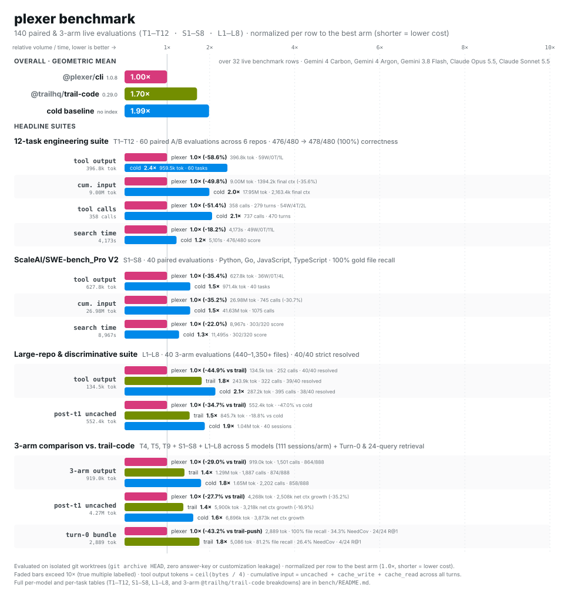

# `plexer`

An offline structural code graph and call-chain indexer for AI coding agents. It indexes symbols, call edges, imports, and exact line spans into a local `plexer/` directory using WASM Tree-sitter so agents can resolve definitions, callers, and blast radius in a single turn.

- **Fewer tokens and tool calls:** Cuts tool output tokens by 50–73% (`59W/1L` on `T1`–`T12`) and tool calls by 43–67% across 140 paired and 3-arm evaluations ([see benchmarks](#benchmarks)).
- **Fast local search:** Hits 100.0% Recall@1 and 1.000 MRR in 7–21ms on natural-language queries across 6 repositories (`75–96%` smaller than raw files).
- **25 languages:** Parses TypeScript/JS, Python, Go, Rust, Java, C/C++, C#, Kotlin, Swift, Ruby, PHP, and more out of the box, including full Luau and Roblox project support.
- **12 AI coding hosts:** One command configures skills, hooks, and MCP tools for Claude Code, Google Antigravity, OpenAI Codex, Cursor, Gemini CLI, Windsurf, GitHub Copilot, Aider, Kiro, OpenCode, Grok CLI, and Amp.
- **Web graph explorer:** Serves a 60fps HTML5 Canvas viewer for inspecting architecture, health hotspots, and diff blast radius (`plexer viz`).

---

## Quickstart

Requires **Node.js >= 20**.

```bash
npm install -g @plexer/cli

plexer init --global   # One-time setup: ~/.local/bin/plexer + global skills, hooks & MCP
plexer init            # Index current repo (<repo>/plexer/) and wire detected AI tools

plexer ask "freshness fingerprints" --source         # Rank symbols and inline L<n>: source
plexer callers resolveSymbol --depth 2               # Trace multi-hop incoming callers
plexer skeleton src/graph/traverse.js                # List file signatures and line spans
plexer read src/graph/traverse.js:parseWalkDepth     # Read exact <file:symbol> or <file:Lx-Ly> spans
plexer blast --base main --markdown                  # Generate diff blast radius report
plexer viz                                           # Launch local 60fps Canvas graph viewer
```

Run `plexer retract` at any time to remove every host edit cleanly.

<p align="center">
  
</p>

Once initialized, your coding agent uses `plexer` automatically:
- **Turn-1 orientation:** Lifecycle hooks (`SessionStart`, `UserPromptSubmit`, `PreInvocation`) inject a compact repo map and prompt-matched symbol spans before the first tool call.
- **Live blast-radius warnings:** `PostToolUse` hooks warn on downstream caller impact after edits. Every CLI and MCP query incrementally re-parses modified files in ~3ms before answering.
- **Native MCP server (`plexer mcp`):** Exposes `plexer_find_code`, `plexer_read`, `plexer_trace_calls`, `plexer_find_all`, `plexer_file_api`, `plexer_repo_map`, `plexer_blast`, `plexer_health`, and `plexer_check_freshness` over stdio with `readOnlyHint` annotations.

---

## Commands

All query commands refresh modified files automatically and accept `--json` and `--no-refresh`. Run `plexer <command> --help` for full flag details.

| Command | Description |
| :--- | :--- |
| `plexer init [dir]` | Build `plexer/` and wire AI hosts (`--global`, `--agents <ids...>`, `--list-agents`, `--dry-run`, or alias `setup`). |
| `plexer build [dir]` | Build or incrementally refresh `plexer/` (`-e <exts...>`, `--only-dir <path>`, `--cards`). |
| `plexer ask <queries...>` | Rank symbols by BM25F + PageRank (`--source`, `--full`, `-n <limit>`, `--in <path>`). |
| `plexer read <spans...>` | Read exact `L<n>:` source for `<file:symbol>`, `<file:Lx-Ly>`, or `<file>` without reading whole files. |
| `plexer grep <patterns...>` | Run regex or literal search grouped by enclosing symbol and ranked by caller count (`--fixed`, `-i`, `--in <path>`). |
| `plexer callers <syms...>` | Walk incoming `calls`, `imports`, `extends`, `implements`, and `references` edges (`-d <depth\|all>`, `--source`). |
| `plexer callees` / `impact` | Walk outgoing callees or multi-hop incoming callers (`--depth 2` default on `impact`). |
| `plexer skeleton <files...>` | Print file signatures, exact line spans, and doc summaries (`--all-matches`). |
| `plexer map [dir]` | Show directory clusters, hub symbols, and hotspots (`--max-dirs <n>`). |
| `plexer blast [dir]` | Compute git diff blast radius (`--base <ref>`, `--markdown`, `--mermaid`, `--export-viz <dir>`). |
| `plexer health [sub]` | Run the codebase health scanner, execution queue (`scan`, `next`, `resolve`, `suppress`, `plan`, `review`, `autofix`, `move`, `tree`, `viz`, `detect`, `status`, `prompt`), and 20-dimension scorecard (`--diff`, `--in <path>`). |
| `plexer viz [dir]` | Start the 60fps HTML5 Canvas graph server (`-p <port>`, `--export <dir>`). |
| `plexer check` / `retract` | Verify index hash freshness (`check`) or remove host wiring (`retract` / `uninstall`). |

---

## Codebase Health Loop (`plexer health`)

`plexer health` pairs graph and AST detectors (dead code, duplication, cycles, cohesion, complexity, test gaps, and Luau/Roblox checks) with blind LLM review. Findings live in a persistent execution queue under `plexer/.health/`.

Paste this prompt into your agent (or print it with `plexer health prompt`):

```text
I want you to systematically improve the quality of this codebase using `plexer health`.
Run ALL of the following:

Before scanning, check for directories that should be excluded (vendor, build output,
generated code, packages, worktrees, etc.) and exclude obvious ones with `plexer health exclude <path>`.
Share any questionable candidates with me before excluding.

plexer health scan .
plexer health next

Your goal is to get the **strict score** as high as possible (target >= 98). The scoring
resists gaming — the only way to improve it is to genuinely make the code better.

THE LOOP: run `plexer health next`. It is the execution queue from the living plan, not the
whole backlog. It tells you what to fix now, which file and lines, and the exact
`plexer health resolve` command to run when done.
Fix it, resolve it, run `plexer health next` again. Over and over. This is your main job.

Use `plexer health backlog` only when you need to inspect broader open work that is not
currently driving execution.

Don't be lazy. Large refactors and small detailed fixes — do both with equal energy. No task
is too big or too small. Fix things properly, not minimally. Use `plexer callers`, `plexer blast`,
and `plexer health move` to verify blast radius and update all callers cleanly.

Use `plexer health plan` / `plexer health plan reorder` to reorder priorities or cluster related
issues (`plexer health plan cluster create <name>`). When subjective review is surfaced by `next`,
run `plexer health review --prepare`, evaluate dimensions blindly against
`plexer/.health/review_packet_blind.json`, and import with `plexer health review --import <file>`.
Rescan periodically with `plexer health scan`. Follow the scan output's agent instructions.
```

---

## Benchmarks

Evaluated on **Gemini 4 Carbon** (`medium`), **Gemini 4 Argon** (`low` and `medium`), **Gemini 3.8 Flash** (`medium`), **Claude Sonnet 5.5**, and **Claude Opus 5.5** across **28 tasks (`T1`–`T12`, `S1`–`S8`, `L1`–`L8`)** and **11 repositories** up to **1,350+ files** (**140 paired and 3-arm evaluations**). Full per-model tables, per-task breakdowns (`T1`–`T12`, `S1`–`S8`, `L1`–`L8`), repo-size scaling tables, and reproduction scripts are in [`bench/README.md`](bench/README.md).

<p align="center">
  
</p>

| Evaluation Suite | Correctness / Resolved | Tool Calls | Tool Output Tokens | Uncached Input (`in + cw`) | Cumulative Input Tokens | Search Wall Time |
| :--- | :---: | :---: | :---: | :---: | :---: | :---: |
| **12-Task Suite (`T1`–`T12`, 60 pairs)** | 476/480 → **478/480 (99.6%)** | 737 → **358 (-51.4%)** | 959.5k → **396.8k (-58.6%, `59W/1L`)** | 2.54M → **1.83M (-27.9%)** | 17.95M → **9.00M (-49.8%)** | 5,101s → **4,173s (-18.2%)** |
| **`SWE-bench_Pro` V2 (`S1`–`S8`, 40 pairs)** | 302/320 → **303/320** (`100%` file recall) | 1,075 → **745 (-30.7%)** | 971.4k → **627.8k (-35.4%, `36W/4L`)** | 3.79M → **2.54M (-33.0%)** | 41.63M → **26.98M (-35.2%)** | 11,495s → **8,967s (-22.0%)** |
| **Large-Repo Suite (`L1`–`L8`, 40 3-arm)** | 316/320 → **320/320 (40/40 resolved)** | 395 → **252 (-36.2%)** | 287.2k → **134.5k (-53.2%)** | 2.00M → **1.54M (-23.1%)** | 6.22M → **3.66M (-41.2%)** | 1,705s → **1,331s (-21.9%)** |
| **Live 3-Arm vs. `trail` (`111 tasks/arm`)** | **`plexer` 864/888** (`trail` 874/888, `cold` 858/888) | **1,501 (-31.8%)** (`trail` 1,887, `cold` 2,202) | **919.0k (-29.0% vs `trail`)** (`trail` 1.29M, `cold` 1.65M) | **6.82M (-28.6%)** (`trail` 8.38M **-12.4%**, `cold` 9.56M) | **51.75M (-37.4%)** (`trail` 71.85M, `cold` 82.61M) | **11,741s (-19.2%)** (`trail` 14,504s, `cold` 14,524s) |

- **Uncached input tokens, warm-cache Q&A, and repo-size scaling (`node bench/trail-table.js`):** Across Q&A tasks (`T1`–`T8`), `plexer` cuts warm-cache uncached input tokens (`input + cache_creation`) by **-42% on Gemini 4 Carbon (`35,144 → 20,279`)**, **-41% on Opus 5.5 (`11,331 → 6,665`)**, and **-31% on Sonnet 5.5 (`8,377 → 5,786`)**. Post-Turn-1 exploration uncached tokens drop by **-53% on Carbon (`42,976 → 20,036`)** and **-78% on both Opus (`10,031 → 2,193`) and Sonnet (`7,235 → 1,572`)**. Across all 111 shared 3-arm tasks (`T4, T5, T9`, `S1`–`S8`, and `L1`–`L8` across 5 models), native `trail` (`@trailhq/trail-code@0.29.0`) cuts raw uncached input by `-12.4%` (`9,564k → 8,380k`), post-Turn-1 exploration uncached tokens by `-14.4%` (`6,896k → 5,900k`), net context growth by `-16.9%` (`3,873k → 3,218k`), cumulative input by `-13.0%` (`82.61M → 71.85M`), and tool calls by `-14.3%` (`2,202 → 1,887`). `plexer` cuts them by **`-28.6%` (`6,824k`)**, **`-38.1%` (`4,268k`)**, **`-35.2%` (`2,508k`)**, **`-37.4%` (`51.75M`)**, and **`-31.8%` (`1,501` calls)** while hitting **`100.0%` gold file recall (`111/111`)** across `Small (<250 files)`, `Medium (350–750 files)`, and `Large (700–1350+ files)` repositories.
- **Retrieval and latency (`npm run bench`):** Hits **100.0% Recall@1 (24/24)** and **1.000 MRR** across 6 repos (14,475 symbols, 29,088 edges at pinned benchmark commits) compared to `@trailhq/trail-code@0.25.0` (`16.7% Recall@1` overall, `50.0%` on shared non-Luau repos). Queries finish in **6.8–20.6ms** for `ask --source` and **<2ms** for `callers`, `skeleton`, and `map`.

---

## Supported Hosts & Languages

- **12 AI coding hosts (`plexer init`, `plexer init --list-agents`):** Claude Code (`claude`), Google Antigravity (`antigravity`), OpenAI Codex / `AGENTS.md` (`agents`), Cursor (`cursor`), Gemini CLI (`gemini`), Windsurf (`windsurf`), GitHub Copilot (`copilot`), Aider (`aider`), Kiro (`kiro`), OpenCode (`opencode`), Grok CLI (`grok`), and Amp (`amp`).
- **25 languages (WASM Tree-sitter):**
  - **Deep AST + receiver and import resolution (9):** TypeScript, JavaScript, Python, Go, Java, Kotlin, Swift, PHP, R.
  - **Luau / Roblox (1):** 2024–2026 Luau syntax normalizer, Rojo `default.project.json` DataModel paths, `.luaurc` aliases, `require()`, `Module.fn` / `Class:Method()`, barrel re-exports, and `:GetChildren()` dynamic loaders.
  - **Tag extraction (`tags.scm`) + cross-file calls and imports (15):** Rust, C, C++, C#, Ruby, Scala, Elixir, Solidity, OCaml, Zig, Dart, Clojure, Nix, Lua, and Vue (`<script>`).

---

## Programmatic API

Ships with TypeScript declarations in [`src/index.d.ts`](src/index.d.ts):

```ts
import { Plexer, formatAsk, formatReadSpans, formatSkeleton } from "@plexer/cli";

const plexer = new Plexer();
await plexer.graph("/path/to/repo");

console.log(formatAsk(plexer.ask("/path/to/repo", "freshness fingerprints", { source: true })));
console.log(formatSkeleton(plexer.skeleton("/path/to/repo", "src/graph/fingerprint.js")));
console.log(formatReadSpans(plexer.read("/path/to/repo", ["src/graph/fingerprint.js:probeDrift"])));
```

## License

MIT © Infinit Works
