# `plexer`

**Offline structural code graph for AI coding agents.**

Coding agents burn most of their context window running blind `grep` searches and reading entire files just to find a few relevant lines. `plexer` indexes your repository locally in seconds using pure WASM Tree-sitter—offline, `$0`, with no API keys, embeddings, or native C++ compilation.

It builds a live graph of every symbol, exact `file:line` span, doc summary, and cross-file `calls`, `imports`, `extends`, `implements`, and `references` edge—and incrementally refreshes modified files in milliseconds before every query.

- **56–59% fewer tool output tokens (`48W/0L` across `T1`–`T12`)**, **23–68% fewer cumulative LLM input tokens**, and **45–53% fewer tool calls** across 80 paired A/B evaluations (`160` sessions) on **Antigravity (`argon-low` & `argon-medium`)**, **Claude Opus 5.5 (`claude-opus-5-5 --effort medium`)**, and **Claude Sonnet 5.5 (`claude-sonnet-5-5 --effort medium`)** across both our 12-task suite and **`ScaleAI/SWE-bench_Pro` V2** ([see benchmarks](#benchmarks))
- **91.7% Recall@1 · 100.0% Recall@3 · 100.0% Recall@5** (0.951 MRR) on natural-language intent queries across 17,172 symbols and 31,335 edges (`72–97%` smaller than reading raw files)
- **25 languages out of the box** — TypeScript, JavaScript, Python, Go, Rust, Java, C/C++, C#, Kotlin, Swift, Ruby, PHP, Scala, Elixir, Zig, and more, plus **first-class Luau / Roblox** (`default.project.json`, `.luaurc` aliases, `require()`, and `_K` registries)
- **12 AI coding hosts** — one command wires Claude Code, Google Antigravity, OpenAI Codex, Cursor, Gemini CLI, Windsurf, GitHub Copilot, Aider, Kiro, OpenCode, Grok CLI, and Amp
- **60fps HTML5 Canvas visualizer** — interactive force-directed architecture and diff blast-radius explorer (`plexer viz`)

---

## Quickstart

Requires **Node.js >= 20**.

```bash
npm install -g @plexer/cli

# 1. One-time machine setup (links ~/.local/bin/plexer + global agent skills, hooks, and MCP)
plexer init --global

# 2. Index a repository and wire detected AI coding tools
plexer init
```

`plexer init` writes the graph to `<repo>/plexer/` (automatically git-ignored) and configures your installed AI coding hosts idempotently. Run `plexer retract` at any time to cleanly remove every host edit.

---

## How It Works

<p align="center">
  
</p>

### Automatic Agent Mode

Once initialized, your coding agent uses `plexer` automatically without extra prompts:

- **Turn-1 orientation**: Lifecycle hooks (`SessionStart`, `UserPromptSubmit`, `PreInvocation`) inject a compact repo map and pre-scored symbol spans matching your prompt before the agent makes its first tool call.
- **Live blast-radius warnings**: After every file edit (`PostToolUse`), `plexer` checks the graph in-process and warns the agent if downstream callers or importers were affected.
- **Millisecond freshness**: Every CLI and MCP query probes working-tree `mtime`/`size` drift in ~3ms and re-parses only modified files before answering, so line numbers never go stale.
- **Native MCP server (`plexer mcp`)**: Exposes `plexer_find_code`, `plexer_find_all`, `plexer_trace_calls`, `plexer_file_api`, `plexer_repo_map`, and `plexer_check_freshness` over stdio.

---

## Core Workflows

### 1. Find Code by Intent (`plexer ask "<query>" --source`)

Combines **BM25F lexical scoring** (identifier splitting, stemming, doc summaries) with **Personalized PageRank** over the call and import graph. `--source` inlines definitions up to 35 lines and condenses longer functions into windowed excerpts with explicit `…` gap markers (pass `--full` for whole spans):

```text
$ plexer ask "probing drift and freshness fingerprints" --source
plexer ask — "probing drift and freshness fingerprints"  (lexical)

1. probeDrift · function  [symbol]
   src/graph/fingerprint.js:L97-L163
   Fast working-tree drift check against the saved freshness stamp.

   L97:  export async function probeDrift(root, outDir) {
   L98:      const prev = readFreshness(outDir);
   L100:     const walkCfg = readWalkConfig(root, outDir);
   L113:     for (const [rel, prevEntry] of prevFiles) {
   L120:         if (st.size !== prevEntry.size || Math.floor(st.mtimeMs) !== prevEntry.mtimeMs)
   L121:             return { drifted: true, reason: `modified:${rel}` };
   L155:     return { drifted: false, stamp: prev };
   … (excerpt of src/graph/fingerprint.js:L97-L163, 67 lines — rerun with --full for whole span)
```

### 2. Trace Callers, Callees & Impact (`plexer callers <symbol> --depth 2`)

Walks resolved `calls`, `imports`, `implements`, `extends`, and `references` edges across files. Accepts bare names (`resolveSymbol`), qualified names (`Validate.check`, `Auth:hasPermission`), path selectors (`src/tx.ts:processTransaction`), or comma-separated symbol lists:

```text
$ plexer callers resolveSymbol --depth 2
plexer callers — resolveSymbol · function (src/graph/traverse.js:L44-L120)

depth 1 (4):
  - findSubjectNodes · function  src/ask/ask.js:L170-L180  (calls @ L173)
  - runCallersCommand · function  src/graph/traverse-cli.js:L14-L90  (calls @ L31)
  - callSingleTool · function  src/mcp/tools.js:L60-L185  (calls @ L118)
  - callers · method  src/index.js:L67-L73  (calls @ L71)

depth 2 (3):
  - structural · function  src/ask/ask.js:L185-L260  (calls via findSubjectNodes)
  - callTool · function  src/mcp/tools.js:L187-L215  (calls via callSingleTool)
  - federateCallers · function  src/graph/workspace.js:L385-L440  (calls via runCallersCommand)
```

### 3. Skim a File's API (`plexer skeleton <file>`)

Extracts exported and internal signatures, line spans, and doc summaries without reading the file body (~10× smaller than raw source):

```text
$ plexer skeleton src/graph/traverse.js
plexer skeleton — src/graph/traverse.js
- L44-L120  export function resolveSymbol(graph, query, opts = {}) — Resolve a bare, dotted, colon-qualified, or path:symbol selector.
- L128-L195  export function edgeWalk(graph, start, direction = "in", maxDepth = 1) — BFS traversal over incoming or outgoing graph edges.
- L197-L208  export function parseWalkDepth(raw, fallback = 1)
- L210-L265  export function formatEdgeWalk(symbol, hits, direction = "in", maxDepth = 1)
```

### 4. Audit Diff Blast Radius & Visualize (`plexer blast`, `plexer viz`)

Maps every git diff hunk (`HEAD` or `--base <ref>`) to its enclosing symbols and walks incoming dependents to show what your change could affect:

```bash
plexer blast                        # uncommitted diff blast radius
plexer blast --base main --markdown # PR-ready Markdown impact report + Mermaid diagram
plexer blast --export-viz ./out     # self-contained HTML5 Canvas blast-radius page
plexer viz                          # live local 60fps Canvas graph server
```

---

## Benchmarks

Full methodology, isolation controls, per-task breakdowns (`T1`–`T12`), and reproduction commands live in [`bench/README.md`](bench/README.md).

### Live A/B Agent Evaluation (`plexer` vs. Cold Agent)

#### 1. 12-Task Engineering Suite (`T1`–`T12` Across 4 Explicit Model Configurations)

48 paired A/B sessions (`12 tasks × 4 model tiers`) across **6 repositories** (`plexer`, `kohls-admin`, `flux`, `sert`, plus unseen holdouts `building-tools` and `z`) covering symptom-based bug diagnosis, blast-radius planning, and test-verified multi-file code edits:

| Model Configuration (12 Tasks Each)                | Correctness (`cold` → `plexer`) |     Tool Calls (`cold` → `plexer`)     |    Tool Output Tokens (`cold` → `plexer`)     | Final Context Tokens (`cold` → `plexer`) | Cumulative Input Tokens (`cold` → `plexer`) | Search Wall Time (`cold` → `plexer`) |
| :------------------------------------------------- | :-----------------------------: | :------------------------------------: | :-------------------------------------------: | :--------------------------------------: | :-----------------------------------------: | :----------------------------------: |
| **Antigravity `argon-low`** (`--effort low`)       |    **96/96 → 96/96** (100%)     |   146 → **80 (-45.2%)** (`9W/2T/1L`)   | 263,482 → **108,332 (-58.9%)** (**`12W/0L`**) |       511.5k → **299.8k (-41.4%)**       |         3.19M → **1.70M (-46.6%)**          |      1,017s → **961s (-5.5%)**       |
| **Antigravity `argon-medium`** (`--effort medium`) |    **96/96 → 96/96** (100%)     |  160 → **81 (-49.4%)** (`11W/0T/1L`)   | 254,639 → **111,730 (-56.1%)** (**`12W/0L`**) |       530.2k → **319.0k (-39.8%)**       |         4.63M → **1.51M (-67.5%)**          |      1,525s → **929s (-39.1%)**      |
| **Claude Opus 5.5** (`--effort medium`)            |    94/96 → **96/96 (+2.1%)**    | 81 → **41 (-49.4%)** (**`10W/1T/1L`**) |  63,696 → **27,714 (-56.5%)** (**`12W/0L`**)  |       225.9k → **200.5k (-11.3%)**       |         1.29M → **0.80M (-38.2%)**          |       249s → **122s (-50.8%)**       |
| **Claude Sonnet 5.5** (`--effort medium`)          |    94/96 → **96/96 (+2.1%)**    | 76 → **36 (-52.6%)** (**`11W/0T/1L`**) |  45,198 → **19,882 (-56.0%)** (**`12W/0L`**)  |       187.9k → **183.7k (-2.2%)**        |         0.65M → **0.50M (-23.3%)**          |        97s → **63s (-34.4%)**        |
| **4-Model Total (`48` Task-Model Pairs)**          |  380/384 → **384/384 (100%)**   |  463 → **238 (-48.6%)** (`41W/3T/4L`)  | 627,015 → **267,658 (-57.3%)** (**`48W/0L`**) |     1,455.5k → **1,003.0k (-31.1%)**     |         9.77M → **4.51M (-53.8%)**          |     2,888s → **2,076s (-28.1%)**     |

#### 2. External Multi-Language Benchmark: `ScaleAI/SWE-bench_Pro` V2 (`S1`–`S8` Across 4 Models)

32 paired A/B sessions (`8 tasks × 4 model tiers`) across **Python** (`qutebrowser/qutebrowser`), **Go** (`flipt-io/flipt`), **JavaScript** (`NodeBB/NodeBB`), and **TypeScript** (`tutao/tutanota`):

| Model Configuration (8 Tasks Each)                 | Patch Score (`cold` → `plexer`) | Tool Calls (`cold` → `plexer`) | Tool Output Tokens (`cold` → `plexer`) | Final Context Tokens (`cold` → `plexer`) | Cumulative Input Tokens (`cold` → `plexer`) | Search Wall Time (`cold` → `plexer`) |
| :------------------------------------------------- | :-----------------------------: | :----------------------------: | :------------------------------------: | :--------------------------------------: | :-----------------------------------------: | :----------------------------------: |
| **Antigravity `argon-low`** (`--effort low`)       |        **61/64 → 61/64**        |     239 → **180 (-24.7%)**     |     233,849 → **183,048 (-21.7%)**     |       498.5k → **446.2k (-10.5%)**       |         7.70M → **5.77M (-25.1%)**          |     2,759s → **1,855s (-32.8%)**     |
| **Antigravity `argon-medium`** (`--effort medium`) |        62/64 → **61/64**        |     345 → **180 (-47.8%)**     |     333,078 → **214,257 (-35.7%)**     |       869.7k → **607.7k (-30.1%)**       |         19.69M → **8.03M (-59.2%)**         |     5,686s → **3,394s (-40.3%)**     |
| **Claude Sonnet 5.5** (`--effort medium`)          |        **55/64 → 55/64**        |      65 → **34 (-47.7%)**      |      19,344 → **14,262 (-26.3%)**      |         125.2k → 131.5k (+5.1%)          |        637.0k → **552.4k (-13.3%)**         |       120s → **103s (-13.8%)**       |
| **Claude Opus 5.5** (`--effort medium`)            |    58/64 → **60/64 (+3.4%)**    |        39 → 47 (+20.5%)        |      24,253 → **19,916 (-17.9%)**      |         133.0k → 151.2k (+13.7%)         |          645.6k → 909.8k (+40.9%)           |         193s → 217s (+12.6%)         |

### Retrieval & Query Latency (`npm run bench`)

Evaluated across 6 repositories (**17,172 symbols**, **31,335 edges**) on **24 natural-language intent queries** with zero symbol names or file paths in the prompts:

- **Retrieval accuracy**: **91.7% Recall@1 (22/24)** · **100.0% Recall@3 (24/24)** · **100.0% Recall@5 (24/24)** · **0.951 MRR**

| Repository                  | Nodes / Edges | `wiring.json` | `check` | `ask --source` (Latency / Tokens vs. Raw Files) | `callers` (`d=2`) | `skeleton` |   `map` |
| :-------------------------- | ------------: | ------------: | ------: | :---------------------------------------------- | ----------------: | ---------: | ------: |
| **`plexer`** (JS/TS)        | 1,028 / 3,189 |        804 KB |  18.0ms | **9.1ms** / 1,398 tok (-85% vs. 9,084 raw)      |        **0.33ms** | **0.20ms** |  1.73ms |
| **`kohls-admin`** (Luau)    | 5,878 / 8,176 |      3,630 KB | 109.1ms | **18.8ms** / 1,077 tok (-86% vs. 7,473 raw)     |        **3.14ms** | **0.29ms** | 11.54ms |
| **`flux`** (Luau)           | 1,183 / 1,962 |        665 KB |  16.0ms | **15.9ms** / 1,013 tok (-97% vs. 30,646 raw)    |        **0.68ms** | **0.30ms** |  1.70ms |
| **`sert`** (Luau + Py)      | 2,039 / 3,877 |      1,309 KB |  26.5ms | **9.5ms** / 1,238 tok (-96% vs. 28,010 raw)     |        **1.98ms** | **0.11ms** |  1.71ms |
| **`building-tools`** (Luau) | 1,807 / 4,537 |      1,320 KB |  24.8ms | **7.5ms** / 1,471 tok (-72% vs. 5,306 raw)      |        **1.00ms** | **0.06ms** |  1.71ms |
| **`z`** (Luau + Rust + Py)  | 5,237 / 9,594 |      3,604 KB |  66.9ms | **30.2ms** / 1,435 tok (-92% vs. 18,701 raw)    |        **1.39ms** | **0.32ms** |  8.55ms |

---

## Supported Hosts & Languages

### AI Coding Hosts (`plexer init`)

`plexer init` writes only marker-fenced sections or `plexer`-keyed config entries, preserving all existing rules, MCP servers, and hooks.

| Host ID       | AI Coding Tool               | Repo Instruction File             | MCP & Lifecycle Hooks Wired                                                                                                             |
| :------------ | :--------------------------- | :-------------------------------- | :-------------------------------------------------------------------------------------------------------------------------------------- |
| `claude`      | **Claude Code**              | `.claude/skills/plexer/SKILL.md`  | `.mcp.json`, `.claude/settings.json` (`SessionStart`, `UserPromptSubmit`, `PostToolUse`, `Stop`, statusLine), `~/.claude/settings.json` |
| `antigravity` | **Google Antigravity**       | `AGENTS.md`                       | `~/.gemini/config/mcp_config.json`, `~/.gemini/config/hooks.json` (`PreInvocation`, `PostToolUse`, `Stop`), `~/.gemini/skills/plexer`   |
| `agents`      | **OpenAI Codex / AGENTS.md** | `AGENTS.md`                       | `~/.codex/config.toml`, `~/.codex/hooks.json` (`SessionStart`, `UserPromptSubmit`, `Stop`), `~/.agents/skills/plexer`                   |
| `cursor`      | **Cursor**                   | `.cursor/rules/plexer.mdc`        | `.cursor/mcp.json`                                                                                                                      |
| `gemini`      | **Gemini CLI**               | `GEMINI.md`                       | `.gemini/settings.json`                                                                                                                 |
| `windsurf`    | **Windsurf**                 | `.windsurf/rules/plexer.md`       | Instruction rule                                                                                                                        |
| `copilot`     | **GitHub Copilot**           | `.github/copilot-instructions.md` | Fenced instruction section                                                                                                              |
| `aider`       | **Aider**                    | `CONVENTIONS.md`                  | Fenced instruction section                                                                                                              |
| `kiro`        | **Kiro**                     | `.kiro/steering/plexer.md`        | `.kiro/settings/mcp.json`                                                                                                               |
| `opencode`    | **OpenCode**                 | `AGENTS.md`                       | `opencode.json`                                                                                                                         |
| `grok`        | **Grok CLI**                 | `GROK.md`                         | `.grok/config.toml`                                                                                                                     |
| `amp`         | **Amp**                      | `AGENT.md`                        | Fenced instruction section                                                                                                              |

### Languages (25 via WASM Tree-sitter)

| Tier                  | Languages                                                                                                                                                                                                                                                                                          | Extraction Capabilities                                                                                                                                                                                                                                                                                       |
| :-------------------- | :------------------------------------------------------------------------------------------------------------------------------------------------------------------------------------------------------------------------------------------------------------------------------------------------- | :------------------------------------------------------------------------------------------------------------------------------------------------------------------------------------------------------------------------------------------------------------------------------------------------------------ |
| **Depth (9)**         | TypeScript (`.ts`, `.tsx`, `.mts`, `.cts`), JavaScript (`.js`, `.jsx`, `.mjs`, `.cjs`), Python (`.py`, `.pyi`), Go (`.go`), Java (`.java`), Kotlin (`.kt`, `.kts`), Swift (`.swift`), PHP (`.php`), R (`.r`, `.R`)                                                                                 | Hand-tuned AST extractors, receiver type bindings (`self`, `this`, typed locals/fields), import alias resolution, decorator/interface/inheritance edges, and doc-comment summaries.                                                                                                                           |
| **Luau / Roblox (1)** | Luau (`.luau`)                                                                                                                                                                                                                                                                                     | 2024–2026 Luau syntax normalizer (`@[native]`, `const`, type functions, leading `\|`/`&` unions), Rojo `default.project.json` DataModel paths (`game:GetService`), `.luaurc` `@alias` resolution, `require()` tracking, `Module.fn` / `Class:Method()` calls, table-field alias exports, and `_K` registries. |
| **Breadth (14)**      | Rust (`.rs`), C (`.c`, `.h`), C++ (`.cpp`, `.cc`, `.cxx`, `.hpp`, `.hh`), Ruby (`.rb`), C# (`.cs`), Scala (`.scala`, `.sc`), Elixir (`.ex`, `.exs`), Solidity (`.sol`), OCaml (`.ml`, `.mli`), Zig (`.zig`), Dart (`.dart`), Clojure (`.clj`, `.cljs`, `.cljc`, `.bb`), Nix (`.nix`), Lua (`.lua`) | Tree-sitter `tags.scm` query extraction + cross-file call, `use`/`#include`/import, and doc-comment summary extraction.                                                                                                                                                                                       |
| **Container (1)**     | Vue (`.vue`)                                                                                                                                                                                                                                                                                       | Extracts `<script>` blocks and delegates to the TypeScript/JavaScript extractor with line-offset preservation.                                                                                                                                                                                                |

---

## CLI Reference

All query commands (`ask`, `grep`, `callers`, `callees`, `impact`, `skeleton`, `map`, `blast`) automatically refresh modified files before answering and accept `--json` and `--no-refresh`.

| Command                          | Description & Key Flags                                                                                                                                                                                                |
| :------------------------------- | :--------------------------------------------------------------------------------------------------------------------------------------------------------------------------------------------------------------------- |
| `plexer init [dir]`              | Build `plexer/` and wire detected AI hosts (`-g, --global`, `--agents <ids...>`, `--all-agents`, `--no-agents`, `--list-agents`, `--no-mcp`, `--no-hooks`, `--no-statusline`, `--no-build`, `--dry-run`, `-y, --yes`). |
| `plexer setup`                   | Alias for `plexer init --global` (links `~/.local/bin/plexer`, global skills, hooks, and MCP).                                                                                                                         |
| `plexer build [dir]`             | Build or incrementally refresh `plexer/` (`-e, --extensions <exts...>`, `--no-reuse`, `--include-dir <name>`, `--only-dir <path>`, `--follow-submodules`, `--follow-nested-repos`, `--no-gitignore`, `--no-ignore`).   |
| `plexer ask <query> [dir]`       | Rank symbols by BM25F + PageRank (`--source`, `--full`, `-n, --limit <n>`, `--in <path>`, `--no-graph-rank`).                                                                                                          |
| `plexer grep <pattern> [dir]`    | Regex/literal search grouped by enclosing symbol and ranked by caller count (`--fixed`, `-i, --ignore-case`, `-C, --context <lines>`, `--source`, `--in <path>`).                                                      |
| `plexer callers <syms...> [dir]` | Walk incoming edges to one or more symbols (`-d, --depth <n\|all>`, `--direction <in\|out>`, `--source`, `--full`, `--in <path>`).                                                                                     |
| `plexer callees <syms...> [dir]` | Walk outgoing edges from one or more symbols (`-d, --depth <n\|all>`, `--source`, `--full`, `--in <path>`).                                                                                                            |
| `plexer impact <syms...> [dir]`  | Transitive callers (`--depth 2` default) to inspect refactor impact (`-d, --depth <n\|all>`, `--source`, `--full`, `--in <path>`).                                                                                     |
| `plexer skeleton <file> [dir]`   | File signatures, spans, and doc summaries (`--all-matches`).                                                                                                                                                           |
| `plexer map [dir]`               | Architectural overview: directory clusters, hub symbols, and hotspots (`--max-dirs <n>`).                                                                                                                              |
| `plexer blast [dir]`             | Diff blast radius over incoming edges (`--base <ref>`, `-d, --depth <n\|all>`, `--format <text\|markdown\|mermaid\|json>`, `--markdown`, `--mermaid`, `--export-viz <dir>`, `--no-owners`, `--pr-author <who...>`).    |
| `plexer viz [dir]`               | Interactive 60fps HTML5 Canvas graph viewer (`-p, --port <port>`, `--no-open`, `--export <dir>`, `--title <text>`, `--tabs <list>`).                                                                                   |
| `plexer check [dir]`             | Verify `plexer/` against disk by content hash; exits `1` on drift (`-e, --extensions <exts...>`).                                                                                                                      |
| `plexer retract [dir]`           | Cleanly remove `plexer` wiring from repo and global host configs (alias: `plexer uninstall`; `-y, --yes`, `--dry-run`, `--keep-cache`, `--no-global`).                                                                 |
| `plexer mcp [dir]`               | Start the Model Context Protocol (MCP) server over stdio.                                                                                                                                                              |

---

## Programmatic API

`@plexer/cli` ships with TypeScript declarations ([`src/index.d.ts`](src/index.d.ts)):

```ts
import { Plexer, formatAsk, formatSkeleton } from "@plexer/cli";

const plexer = new Plexer();

await plexer.graph("/path/to/repo");

const pack = plexer.ask("/path/to/repo", "validating freshness fingerprints", {
	source: true,
	limit: 5,
});
console.log(formatAsk(pack));

const callers = plexer.callers("/path/to/repo", "probeDrift", { depth: 2 });
const skel = plexer.skeleton("/path/to/repo", "src/graph/fingerprint.js");
console.log(formatSkeleton(skel));
```

---

## License

MIT © Infinit Works
