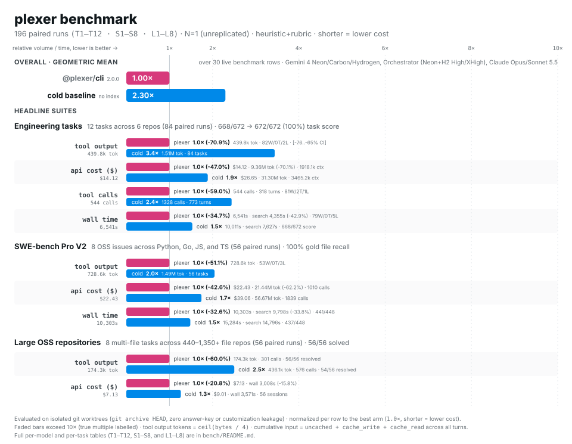

<div align="right">
<a href="https://github.com/infinit-works/plexer"></a>
<a href="https://www.npmjs.com/package/@plexer/cli"><picture><source media="(prefers-color-scheme: dark)" srcset="https://raw.githubusercontent.com/infinit-works/plexer/main/.github/img/link-npm-dark.svg"></picture></a>
<a href="https://github.com/infinit-works/plexer/blob/main/bench/README.md"><picture><source media="(prefers-color-scheme: dark)" srcset="https://raw.githubusercontent.com/infinit-works/plexer/main/.github/img/link-benchmarks-dark.svg"></picture></a>
<a href="https://github.com/infinit-works/plexer/releases"><picture><source media="(prefers-color-scheme: dark)" srcset="https://raw.githubusercontent.com/infinit-works/plexer/main/.github/img/link-releases-dark.svg"></picture></a>
<a href="https://discord.gg/kohl"><picture><source media="(prefers-color-scheme: dark)" srcset="https://raw.githubusercontent.com/kohltastrophe/kohltastrophe/main/.github/img/link-discord-dark.svg"></picture></a>
</div>
<br/>
<br/>
<br/>
<br/>

<div align="center">

# Index once. Read less. Ship faster.

_Plexer builds a local SQLite code graph for coding agents. It indexes symbols, call edges, and exact line spans so agents retrieve definitions, callers, and blast radius without paging through files._

[](https://github.com/infinit-works/plexer/actions/workflow/status/infinit-works/plexer/release.yml) [](https://www.npmjs.com/package/@plexer/cli) [](https://github.com/infinit-works/plexer/blob/main/LICENSE) [](https://github.com/infinit-works/plexer/releases)

---

<picture><source media="(prefers-color-scheme: dark)" srcset="https://raw.githubusercontent.com/infinit-works/plexer/main/.github/img/h3-index-dark.svg"></picture>

<picture><source media="(prefers-color-scheme: dark)" srcset="https://raw.githubusercontent.com/infinit-works/plexer/main/assets/how-it-works-dark.svg"></picture>

</div>

Bundled WASM Tree-sitter grammars parse 36 languages and single-file components into `<repo>/plexer/` backed by `node:sqlite` WAL storage. Dirty-cone rebuilds re-parse changed modules and affected importers.

---

<div align="center">

<picture><source media="(prefers-color-scheme: dark)" srcset="https://raw.githubusercontent.com/infinit-works/plexer/main/.github/img/h3-read-dark.svg"></picture>

<div align="left">

Requires **Node.js >= 22.13** (uses built-in `node:sqlite`).

```bash
npm install -g @plexer/cli

plexer init --global   # Link ~/.local/bin/plexer and install global skills, hooks, and opt-in MCP
plexer init            # Index this repository (<repo>/plexer/) and wire detected hosts

plexer ask "parseWalkDepth" -n 1                     # Rank symbols with call sites and <n>: source
plexer callers parseWalkDepth --depth 2              # Trace incoming callers across 2 hops
plexer skeleton src/graph/traverse.js                # List file signatures and line spans
plexer read src/graph/traverse.js:parseWalkDepth     # Read exact <file:symbol> or <file:Lx-Ly> spans
plexer blast --base main --markdown                  # Compute diff blast radius against main
plexer health scan                                   # Audit codebase health and build triage queue
plexer viz                                           # Open the local HTML5 Canvas explorer
```

Sample output (`plexer ask "parseWalkDepth" -n 1`):

```text
plexer ask — "parseWalkDepth"  (lexical)

1. parseWalkDepth · function — src/graph/traverse.js:L11-L20
   Parse a walk depth (`number | "all" | "full" | "max" | undefined`) into a positive integer or `Infinity` (returns `NaN` when invalid).
   related: ← resolveTraceDepth (src/mcp/tools.js:L319-L324)
   call sites (5):
     ← blastRadius (src/blast/blast.js:L921-L956) → 924: const parsedDepth = parseWalkDepth(opts?.depth, 2);
     ← blastRadiusFromDir (src/blast/blast.js:L60-L83) → 72: const parsedDepth = parseWalkDepth(dirOpts.depth, 2);
     ← blastRadiusIn (src/blast/blast.js:L1210-L1246) → 1215: const parsedDepth = parseWalkDepth(depth, 2);
     ← resolveCliDepth (src/graph/traverse-cli.js:L747-L756) → 750: const d = parseWalkDepth(raw, defaultDepth);
     ← callers (src/index.js:L813-L832) → 815: const depth = parseWalkDepth(opts.depth, 1);

11: export function parseWalkDepth(raw, defaultDepth = 1) {
12:     if (raw === undefined || raw === null)
13:         return defaultDepth;
14:     if (raw === Number.POSITIVE_INFINITY)
15:         return Number.POSITIVE_INFINITY;
16:     if (typeof raw === "string" && /^(all|full|max)$/i.test(raw.trim()))
17:         return Number.POSITIVE_INFINITY;
18:     const d = Number(raw);
19:     return Number.isFinite(d) && d >= 1 ? Math.floor(d) : Number.NaN;
20: }
```

Lifecycle hooks run automatically across Claude Code, Google Antigravity, Codex, Gemini CLI, and Cursor through the local `plexerd` socket daemon. On Turn 0, hooks emit `0 B` on unrelated prompts and inject grounded `<n>:` spans when indexed symbols match. Pre-tool hooks snap reads to unseen AST ranges, deduplicate repeated searches and diffs, and route shell lookups through `plexer`. Post-edit hooks refresh modified files and warn when signature changes affect callers. Run `plexer uninstall --yes` (or `plexer retract --yes`) to remove host wiring cleanly.

</div>

---

<picture><source media="(prefers-color-scheme: dark)" srcset="https://raw.githubusercontent.com/infinit-works/plexer/main/.github/img/h3-ship-dark.svg"></picture>

<a href="https://github.com/infinit-works/plexer/blob/main/bench/README.md"></a>

</div>

We ran **196 paired live evaluations (392 sessions)** against a cold baseline across **28 tasks**, **7 model configurations** (Google Antigravity `Gemini 4 Neon`, `Carbon`, `Hydrogen`, and `Orchestrator` `High`/`XHigh`, plus Claude Code `Opus 5.5` and `Sonnet 5.5`), and **11 repositories** up to **1,350+ files**. Overall, `plexer` cuts cumulative input tokens by **63.5%** (`95.3M → 34.8M`), tool output by **61.0%**, uncached input by **48.4%**, tool calls by **50.4%**, and search time by **35.5%**, while raising accuracy from `98.8%` to **`99.6%`**. Full methodology, Track A regression checks, and Track B v2 suites live in [`bench/README.md`](https://github.com/infinit-works/plexer/blob/main/bench/README.md).

| Benchmark Suite | Input Tokens | Tool Output | Tool Calls | Search Time | Accuracy |
| :--- | :---: | :---: | :---: | :---: | :---: |
| **Engineering tasks** (12 tasks, 6 repos, 84 pairs) | **-70.1%** (`31.30M → 9.36M`) | **-70.9%** (`1,512k → 440k`) | **-59.0%** (`1,328 → 544`) | **-42.9%** (`7,627s → 4,355s`) | **100.0%** (`672/672` vs. `668/672`) |
| **SWE-bench Pro V2** (8 OSS issues, 56 pairs) | **-62.2%** (`56.67M → 21.44M`) | **-51.1%** (`1,491k → 729k`) | **-45.1%** (`1,839 → 1,010`) | **-33.8%** (`14,796s → 9,798s`) | **98.4%** (`441/448` vs. `437/448`) |
| **Large OSS repos** (440–1,350+ files, 56 pairs) | **-45.6%** (`7.32M → 3.98M`) | **-60.0%** (`436k → 174k`) | **-47.7%** (`576 → 301`) | **-23.8%** (`2,598s → 1,979s`) | **100.0%** (`56/56` solved vs. `54/56`) |
| **All 196 paired evaluations** (28 tasks × 7 models) | **-63.5%** (`95.3M → 34.8M`) | **-61.0%** (`3,439k → 1,343k`) | **-50.4%** (`3,743 → 1,855`) | **-35.5%** (`25,021s → 16,132s`) | **99.6%** (`1,561/1,568` vs. `1,549/1,568`) |

Offline engine suites verify retrieval accuracy, negative controls, zero leakage (`npm run bench:leakage`), and 25k-node scale:

| Offline Suite | Coverage | Measured Results |
| :--- | :--- | :--- |
| `npm run bench` | 24 queries across 6 repos | **100.0% Recall@1** (`24/24`), **1.000 MRR**, **6.8–20.6ms** (`0.01–1.74ms` for `callers`/`skeleton`/`map`) |
| `npm run bench:hard` | 116 hard & negative queries | **99.0% Recall@1**, **100.0% Recall@3**, **0.995 MRR**, **0.0%** negative false positives |
| `npm run bench:scale` | 27,092 nodes, 37,512 edges | **2,078.6ms** cold build, **107.2ms** 1-file dirty cone, **9.18ms** p50 (`13.05ms` p95) `ask --source`, **26.63ms** daemon RPC, **339 MB** RSS |

---

## Hosts & Integrations

`plexer init` detects installed coding agents (`plexer init --list-agents` lists all 12 IDs) and writes host instructions, skills, lifecycle hooks, or MCP configs.

| Host | ID | Instructions / Skills | Lifecycle Hooks & Extras | MCP (`plexer mcp`) |
| :--- | :--- | :--- | :--- | :--- |
| **Claude Code** | `claude` | Skill + instructions | Full hooks + statusline | Opt-in (`--mcp`) |
| **Google Antigravity** | `antigravity` | Antigravity 2 plugin + skills | Full hooks + live Canvas sidecar | Opt-in (`--mcp`) |
| **Codex / `AGENTS.md` CLIs** | `agents` | `AGENTS.md` + global skill | Full hooks (`~/.codex/hooks.json`) | Opt-in (`--mcp`) |
| **Gemini CLI** | `gemini` | `GEMINI.md` + global skill | `BeforeAgent` / `BeforeTool` / `AfterTool` hooks | Opt-in (`--mcp`) |
| **Cursor** | `cursor` | `.cursor/rules/plexer.mdc` | Prompt & post-edit hooks (`.cursor/hooks.json`) | Default on (`.cursor/mcp.json`) |
| **Windsurf** | `windsurf` | `.windsurf/rules/plexer.md` | — | Default on |
| **GitHub Copilot** | `copilot` | `.github/copilot-instructions.md` | — | Default on (`.vscode/mcp.json`) |
| **OpenCode** | `opencode` | `AGENTS.md` | — | Default on (`opencode.json`) |
| **Kiro** | `kiro` | `.kiro/steering/plexer.md` | — | Default on (`.kiro/settings/mcp.json`) |
| **Grok (xAI)** | `grok` | `.grok/skills/plexer/SKILL.md` | — | Default on (`.grok/config.toml`) |
| **Hermes Agent** | `hermes` | `AGENTS.md` | — | CLI via instructions |
| **AdaL** | `adal` | `.adal/skills/plexer/SKILL.md` | — | CLI via skill |

For editors without hook support, `plexer mcp` runs a newline-delimited JSON-RPC 2.0 stdio server exposing 9 `plexer_*` tools (`plexer_find_code`, `plexer_read`, `plexer_trace_calls`, `plexer_find_all`, `plexer_file_api`, `plexer_repo_map`, `plexer_blast`, `plexer_health`, `plexer_check_freshness`). Multi-root queries automatically federate repositories declared in `.code-workspace` or `plexer/workspace.json`.

## Codebase Health & Visualization

`plexer health` pairs 10 static AST and graph detector categories (duplicates, dead code, coupling, cohesion, tests, catches, types, traps, slop, and security, including Luau/Roblox checks) with 20 subjective review dimensions. Findings feed a persistent triage queue in `plexer/.health/` with commands for `scan`, `next`, `resolve`, `suppress`, `plan`, `review`, `autofix --dry-run`, `move`, and `viz`.

`plexer viz` serves an interactive 60fps HTML5 Canvas explorer with graph, module, symbol, outline, and treemap views (or writes one standalone HTML page with `--export <dir>`). In Google Antigravity, the bundled plugin (`plugin.json`, `hooks.json`) opens this explorer directly in a live sidecar pane (`sidecar://plexer/viz/`).

## CLI Reference

Global flags work across subcommands: `--dir <path>` overrides `<repo>/plexer`, `--session <id>` deduplicates repeated span reads, and `--no-daemon` skips the `plexerd` socket fast path. Query commands refresh modified files automatically unless `--no-refresh` is set, and support `--json`.

| Command | What it does |
| :--- | :--- |
| `plexer init [dir]` | Build `<repo>/plexer/` and wire detected hosts (`--global` for binary, skills, hooks, and opt-in `--mcp`) |
| `plexer ask <queries...>` | Rank symbols by BM25F and PageRank with inline `<n>:` source excerpts |
| `plexer skeleton <files...>` | Print symbol signatures, line spans, and doc summaries without reading full bodies |
| `plexer read <spans...>` | Read exact `<file:symbol>` or `<file:Lx-Ly>` spans and coalesce overlaps |
| `plexer callers <symbols...>` | Walk incoming callers (`callees` walks outgoing; `impact` defaults to depth 2) |
| `plexer grep <patterns...>` | Search indexed files by regex or fixed string grouped by enclosing symbol |
| `plexer map [dir]` | Summarize directory clusters, global hubs, and git churn hotspots |
| `plexer blast [baseOrDir]` | Compute git diff blast radius with test coverage and owner hints |
| `plexer health [sub]` | Scan codebase health and manage the `plexer/.health/` triage queue |
| `plexer viz [dir]` | Serve the local HTML5 Canvas viewer or export standalone HTML |

<details>
<summary>Full CLI reference (all 18 commands and flags)</summary>

| Command | Purpose and Flags |
| :--- | :--- |
| `plexer version` | Print the installed `@plexer/cli` version. |
| `plexer init [dir]` | Build `plexer/` and wire detected hosts (`-g`/`--global`, `--no-global`, `--no-bin`, `--no-skills`, `--no-build`, `--agents <ids...>`, `--all-agents`, `--no-agents`, `--list-agents`, `--mcp`, `--no-mcp`, `--no-hooks`, `--no-statusline`, `--dry-run`, `-y`/`--yes`). |
| `plexer setup` | Install global binary symlink, skill symlinks, hooks, and optional `--mcp` (`--agents <ids...>`, `--no-bin`, `--no-skills`, `--mcp`, `--no-mcp`, `--no-hooks`, `--dry-run`). |
| `plexer uninstall [dir]` | Remove host wiring and optionally `plexer/` (`alias: retract`, `-y`/`--yes`, `--dry-run`, `--keep-cache`, `--no-global`, `--json`). |
| `plexer build [dir]` | Build or incrementally refresh the graph (`-e`/`--extensions <exts...>`, `--no-reuse`, `--follow-submodules`, `--follow-nested-repos`, `--include-dir <name>`, `--only-dir <path>`, `--cards`, `--no-gitignore`, `--no-ignore`). |
| `plexer check [dir]` | Report added, changed, removed, or stale files against the built graph (`-e`, `--json`). |
| `plexer ask <queries...>` | Rank symbols by BM25F and PageRank (`-n <limit>`, `--source`, `--no-source`, `--full`, `--in <path>`, `--no-graph-rank`, `--json`, `--no-refresh`). |
| `plexer skeleton <files...>` | List symbol signatures, line spans, and doc summaries (`--all-matches`, `--json`, `--no-refresh`). |
| `plexer read <spans...>` | Read exact `<n>:` ranges for `<file:symbol>` or `<file:Lx-Ly>` spans (`--full`, `--callers`, `--json`, `--no-refresh`). |
| `plexer grep <patterns...>` | Search indexed files by regex or fixed string (`-i`, `-F`/`--fixed`, `-C <lines>`, `--source`, `--no-source`, `--full`, `--in <path>`, `--json`, `--no-refresh`). |
| `plexer callers <symbols...>` | Walk incoming edges (`--direction <in\|out>`, `-d`/`--depth <n\|all>`, `--source`, `--no-source`, `--full`, `--in <path>`, `--json`, `--no-refresh`). |
| `plexer callees <symbols...>` | Walk outgoing edges (`-d`/`--depth <n\|all>`, `--source`, `--no-source`, `--full`, `--in <path>`, `--json`, `--no-refresh`). |
| `plexer impact <symbols...>` | Walk 2-hop incoming callers (`-d`/`--depth <n\|all>`, `--source`, `--no-source`, `--full`, `--in <path>`, `--json`, `--no-refresh`). |
| `plexer map [dir]` | Summarize directory clusters, hub symbols, and git churn (`--max-dirs <n>`, `--churn`, `--json`, `--no-refresh`). |
| `plexer blast [baseOrDir] [dir]` | Compute git diff blast radius (`--base <ref>`, `-d`/`--depth <n\|all>`, `--format <text\|markdown\|mermaid\|json>`, `--markdown`, `--mermaid`, `--json`, `--export-viz <dir>`, `--title <text>`, `--no-owners`, `--pr-author <who...>`, `--no-refresh`). |
| `plexer viz [dir]` | Serve the local HTML5 Canvas viewer (`-p <port>`, `--no-open`, `--export <dir>`, `--title <text>`, `--tabs <context,code,modules,symbols,outline,treemap>`). |
| `plexer mcp [dir]` | Start the newline-delimited JSON-RPC 2.0 MCP server exposing 9 `plexer_*` tools. |
| `plexer health [args...]` | Scan codebase health and manage `plexer/.health/` (`scan`, `next`, `backlog`, `status`, `show`, `resolve`, `suppress`, `plan`, `review`, `autofix`, `move`, `tree`, `viz`, `detect`, `zone`, `exclude`, `directives`, `config`, `prompt`). |

</details>

## Supported Languages

All **36 languages and single-file components** run via bundled WASM Tree-sitter grammars with no external compiler setup. Depth-tier resolution covers **9 core languages** (TypeScript, JavaScript, Python, Go, Java, Kotlin, Swift, PHP, R). Breadth-tier parsing adds **24 languages** including Rust, C, C++, Ruby, C#, Luau, Elixir, and Solidity, alongside **3 SFC containers** (Vue, Svelte, Astro).

<details>
<summary>All 36 languages and file extensions</summary>

| Tier | Count | Languages and Extensions |
| :--- | :---: | :--- |
| **Depth tier** | 9 | TypeScript (`.ts`, `.mts`, `.cts`, `.tsx`), JavaScript (`.js`, `.mjs`, `.cjs`, `.jsx`), Python (`.py`, `.pyi`), Go (`.go`), Java (`.java`), Kotlin (`.kt`, `.kts`), Swift (`.swift`), PHP (`.php`), R (`.r`, `.R`) |
| **Breadth tier** | 24 | Rust (`.rs`), C (`.c`, `.h`), C++ (`.cpp`, `.cc`, `.cxx`, `.hpp`, `.hh`, `.hxx`, `.h++`, `.c++`, `.inl`, `.ipp`, `.tpp`, `.ixx`), Ruby (`.rb`), C# (`.cs`), Scala (`.scala`, `.sc`), Elixir (`.ex`, `.exs`), Solidity (`.sol`), OCaml (`.ml`, `.mli`), Zig (`.zig`), Dart (`.dart`), Clojure (`.clj`, `.cljs`, `.cljc`, `.bb`), Nix (`.nix`), Lua (`.lua`), Luau (`.luau`, plus Rojo `default.project.json` and `.luaurc`), Bash (`.sh`, `.bash`, `.zsh`), SQL (`.sql`), HCL (`.tf`, `.tfvars`, `.hcl`), Protobuf (`.proto`), GraphQL (`.graphql`, `.gql`), Objective-C (`.m`, `.mm`), Haskell (`.hs`), Gleam (`.gleam`), CUDA (`.cu`, `.cuh`) |
| **Container SFCs** | 3 | Vue (`.vue`), Svelte (`.svelte`), Astro (`.astro`) |

</details>

## Architecture

`plexer` persists parsed symbols, call edges, and packed BM25 postings in a local `node:sqlite` WAL database alongside a JSON wiring graph. Dirty-cone incremental updates, adaptive Turn-0 confidence scoring, and the `plexerd` Unix socket daemon keep repeated queries sub-millisecond to tens of milliseconds.

<details>
<summary>Storage layout, ranking, and daemon internals</summary>

- **Storage (`<outDir>/.cache/index.sqlite` & `<outDir>/.graph/wiring.json`):** Schema-v3 SQLite WAL tables store file caches, dependency edges, and packed `Int32Array` `ask_term_postings` across 8 channels (`name`, `path`, `sig`, `summary`, `literals`, `body`, `stem`, `exact_ident`).
- **Manifest mounts & dirty cones:** Project manifests (`default.project.json`, `.luaurc`, `tsconfig.json`, `package.json`, `Cargo.toml`, `go.mod`, `pyproject.toml`) auto-include referenced local dependencies while keeping unreferenced `vendor/` and `node_modules/` directories excluded. On edit, incremental dirty-cone rebuilds binary-merge updated posting slices across modified modules, their importers, and affected barrel re-exports.
- **Turn-0 routing & `plexerd`:** Prompt retrieval classifies prompts as `high` confidence (returning pinned definitions and crux excerpts) or `exploratory` (returning an 8-entry `candidateMap` with caller and callee counts). For repeated hook and CLI invocations, `plexerd` caches repository graphs and session seen-span state over a user-scoped Unix socket (`--no-daemon` bypasses the socket).

</details>

## Programmatic API

Ships with TypeScript declarations in [`src/index.d.ts`](https://github.com/infinit-works/plexer/blob/main/src/index.d.ts). `Plexer.ask`, `Plexer.skeleton`, `Plexer.grep`, and `Plexer.callers` accept a single string or `string[]` batches and federate `.code-workspace` or `plexer/workspace.json` configurations.

```ts
import { Plexer, formatAsk, formatReadSpans, formatSkeleton } from "@plexer/cli";

const plexer = new Plexer();
await plexer.graph("/path/to/repo");

// Single query, batched array query, or workspace federation (.code-workspace / plexer/workspace.json)
const hit = plexer.ask("/path/to/repo", "freshness fingerprints", { source: true });
const batch = plexer.ask("/path/to/app.code-workspace", ["auth guard", "session token"], { source: true });
const apis = plexer.skeleton("/path/to/repo", ["src/graph/fingerprint.js", "src/graph/workspace.js"]);
const refs = plexer.callers("/path/to/repo", ["probeDrift", "resolveSymbol"], { depth: 2 });

console.log(formatAsk(hit));
console.log(batch.map(formatAsk).join("\n"));
console.log(apis.map((s) => formatSkeleton(s)).join("\n"));
console.log(formatReadSpans(plexer.read("/path/to/repo", ["src/graph/fingerprint.js:probeDrift"])));
```

## Sponsors

Plexer is free and MIT-licensed. If Plexer is useful to you or your team, you can support its development through [GitHub Sponsors](https://github.com/sponsors/kohltastrophe) or [Ko-fi](https://ko-fi.com/kohltastrophe).

<div align="center">
  <a href="https://github.com/sponsors/kohltastrophe"></a>&nbsp;&nbsp;<a href="https://ko-fi.com/kohltastrophe"></a>
  <br/><br/>
  <a href="https://github.com/sponsors/kohltastrophe"></a>
</div>

