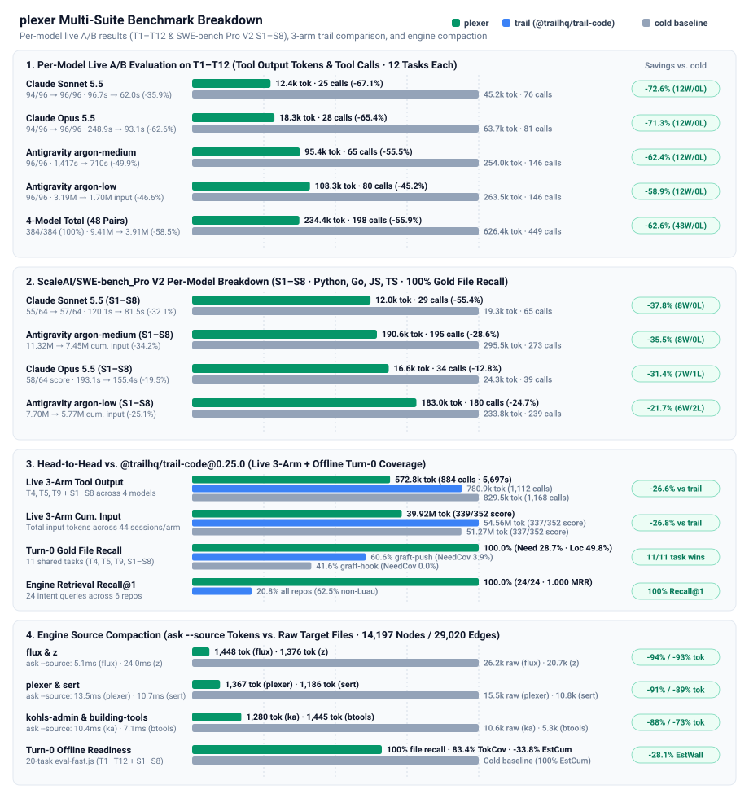

# `plexer` Benchmarks & Methodology

This directory contains the multi-model benchmark suite for `plexer`:
- **Tasks (`T1`–`T12`):** [`bench/tasks.js`](tasks.js) defines 12 engineering tasks (`T1`–`T12`), rubrics, and automated code-edit verification commands across 6 repositories, including 2 holdout repositories.
- **SWE-bench Pro V2 (`S1`–`S8`):** [`bench/swebench/tasks.json`](swebench/tasks.json) bundles 8 tasks (`S1`–`S8`) from **`ScaleAI/SWE-bench_Pro` V2** across Python, Go, JavaScript, and TypeScript (`qutebrowser/qutebrowser`, `flipt-io/flipt`, `NodeBB/NodeBB`, `tutao/tutanota`), along with their container verifier scripts (`test.sh`, `run_script.sh`, `parser.py`, `config.json`).
- **Large-Repo & Discriminative Suite (`L1`–`L8`):** [`bench/large-tasks.js`](large-tasks.js) and [`bench/run-large-ab.js`](run-large-ab.js) define 8 multi-hop architectural and 3–4-file code-edit tasks across large repositories up to **1,350+ files** (`pocketbase/pocketbase`, `tutao/tutanota`, `NodeBB/NodeBB`, `flipt-io/flipt`, `qutebrowser/qutebrowser`), including reference tasks from Trail-Code's PocketBase suite (`L1` OAuth2 + `RecordUpsert` trace; `L5` PR #6744 WebP thumbnail generation & serving) and strict binary `Resolved` verifiers where missing 1 sibling file = `Unresolved`.
- **Transcript Grader:** [`bench/grade.js`](grade.js) parses Antigravity and Claude Code JSONL transcripts, checks cohort symmetry, scores rubrics, strict binary `resolved` status, and tests, and computes separated token metrics (`toolOutputTokens`, `finalContextTokens`, `uncachedInputTokens`, `cachedInputTokens`, `cumulativeInputTokens`, `totalModelOutputTokens`).
- **Antigravity A/B Runner:** [`bench/run-agy-ab.js`](run-agy-ab.js) runs headless Google Antigravity (`agy -p`) evaluations on `carbon-medium` (`gemini-4-carbon-medium --effort medium`), `argon-low` (`gemini-4-argon-low --effort low`), `argon-medium` (`gemini-4-argon-medium --effort medium`), and `flash-medium` (`gemini-3.8-flash-medium --effort medium`).
- **Claude Code A/B Runner:** [`bench/run-claude-ab.js`](run-claude-ab.js) runs headless Claude Code (`claude -p --effort medium`) evaluations on `claude-sonnet-5-5` and `claude-opus-5-5` across `T1`–`T12`.
- **SWE-bench A/B Runner:** [`bench/run-swebench-ab.js`](run-swebench-ab.js) runs `ScaleAI/SWE-bench_Pro` V2 (`S1`–`S8`) across all 5 model configurations, supporting both patch/symbol grading and Docker verification (`SWEBENCH_DOCKER=1`).
- **Offline Fast Evaluator:** [`bench/eval-fast.js`](eval-fast.js) evaluates all 28 tasks (`T1`–`T12` + `S1`–`S8` + `L1`–`L8`) offline in ~5.5s at `$0` API cost. It measures Turn-0 BPE token budgets, file and symbol recall (`100.0%` gold file recall across all 28 tasks), needed-line coverage (`NeedCov` / `LocCov`), and predicted wall time, uncached input, cache-aware cost, and cumulative input (`EstWall`, `EstUncached`, `EstCost`, `EstCum`).
- **Transcript Span Miner:** [`bench/replay.js`](replay.js) and [`bench/needed-spans.json`](needed-spans.json) extract ranged file reads, whole-file reads, grep hits, and gold patch hunks across all 28 tasks into a ground-truth fixture.
- **Coverage Metrics:** [`bench/needcov.js`](needcov.js) computes `needCov` (weighted share of needed lines inlined at Turn 0), `locCov` (share of needed symbols pointed to or inlined), and `fileCov`.
- **Empirical Cost Model:** [`bench/cost-model.js`](cost-model.js) and [`bench/turn-model.json`](turn-model.json) fit per-family cost equations (`wall_ms ~ 1 + turns + outTok`, `outTok ~ 1 + turns`, `uncIn ~ 1 + turns + t0`, `cumIn - (turns + 1)·t0 ~ 1 + (turns + 1)`) and cache-aware cost (`1.25·uncIn + 0.1·cacheRead + 5·outTok`) with leave-one-out cross-validation (`R² = 0.83–0.92`).
- **Offline Trail-Code Comparison:** [`bench/graft-arm.js`](graft-arm.js) compares `plexer` offline against `@trailhq/trail-code@0.29.0` (`graft-hook` and `graft-push`) across all 19 3-arm tasks (`T4`, `T5`, `T9`, `S1`–`S8`, `L1`–`L8`).
- **Live 3-Arm Trail-Code Runner:** [`bench/trail-live-helper.js`](trail-live-helper.js) wires `@trailhq/trail-code@0.29.0` using its native `trail init` architecture (`SessionStart` `formatOrientation` + `UserPromptSubmit` `handlePrompt` `-n 3` pointers/snippets + `PostToolUse` `formatBlastRadius` + unblocked `mcp__trail__*` & `trail` CLI) in isolated worktrees alongside `cold` and `plexer`.
- **Trail-Comparable Metrics:** [`bench/trail-table.js`](trail-table.js) computes per-task means (tool calls, raw & warm-cache uncached input tokens `input + cache_creation`, post-Turn-1 exploration uncached tokens, cache-aware cost, strict binary `Resolved %`, repo-size scaling buckets, and 3-arm `cold` vs `trail` vs `plexer` comparisons) alongside cumulative input tokens and search wall time.
- **Worktree Fixture Builder:** [`bench/ensure-base.js`](ensure-base.js) populates `/tmp/plexer-ab-base/{clean,indexed}` and `/tmp/plexer-swebench-base/{clean,indexed}`.
- **Interactive Evaluation Viewer:** [`bench/skill-review.html`](skill-review.html) renders a self-contained `/skill-creator` evaluation viewer for all paired A/B runs.
- **Benchmark SVG Generator:** [`bench/chart.js`](chart.js) generates [`bench/chart-small.svg`](chart-small.svg) and [`bench/chart.svg`](chart.svg) with automatic light/dark theme support.
- **Engine & Retrieval Benchmark:** [`bench/run.js`](run.js) runs the deterministic engine and retrieval benchmark across 6 repositories and 24 natural-language intent queries (`npm run bench`).

<p align="center">
  
</p>

---

## 1. 5-Model Live A/B Agent Evaluation (`T1`–`T12`: `plexer` vs. Cold Agent)

### Methodology & Controls

We ran a **60-pair (120-session) A/B evaluation** across 12 tasks, 2 arms (`cold` vs. `plexer`), and 5 model configurations:
- **Antigravity `carbon-medium`** (`gemini-4-carbon-medium --effort medium`)
- **Antigravity `argon-low`** (`gemini-4-argon-low --effort low`)
- **Antigravity `argon-medium`** (`gemini-4-argon-medium --effort medium`)
- **Claude Sonnet 5.5** (`claude -p --model claude-sonnet-5-5 --effort medium`)
- **Claude Opus 5.5** (`claude -p --model claude-opus-5-5 --effort medium`)

The suite spans **6 repositories** (`plexer`, `kohls-admin`, `flux`, `sert`, and 2 unseen holdouts `building-tools` and `z`) in JavaScript, Luau, Rust, and Python (1,445 to 3,614 symbols and up to 6,437 edges). Tasks fall into 3 categories:

1. **Bug and behavior diagnosis (`T1`–`T4`):** Diagnose the root mechanism behind a symptom or edge case described in domain terms and cite `file:Lx-Ly` spans.
2. **Refactoring and blast-radius planning (`T5`–`T8`):** Locate a subsystem contract and trace all direct and second-hop callers affected by a proposed change.
3. **Multi-file code edits and test verification (`T9`–`T12`):** Implement a feature across multiple files in an isolated worktree and pass both the existing test suite and a held-out verification spec.

#### Experimental Controls (`bench/grade.js`)

1. **No prompt or answer-key leakage:**
   - Prompts describe user-visible behavior and symptoms rather than internal helper names or file paths.
   - Worktrees are exported via `git archive HEAD` with `bench/`, `AGENTS.md`, `CLAUDE.md`, `GEMINI.md`, `.claude/`, `.cursor/`, `.gemini/`, and `.agents/` stripped. `grade.js` fails any run that accesses `bench/tasks.js`.
2. **Unseen holdout repositories:** `T4` (`z`), `T8` (`building-tools`), and `T12` (`building-tools`) run on repositories never used to tune retrieval weights or skill instructions.
3. **Prompt, effort, and environment symmetry:**
   - Within each model tier, `cold` and `plexer` run with the exact same model, `--effort` flag, tool permissions, and task prompt (`0` symmetry violations across all 120 transcripts).
   - The `cold` arm sets `PLEXER_DISABLE_HOOKS=1` so lifecycle hooks never fire. The `plexer` arm enables Turn-1 prompt-context and post-edit blast-radius hooks (`PLEXER_DISABLE_HOOKS=0`).
   - For Antigravity, [`bench/run-agy-ab.js`](run-agy-ab.js) runs `agy -p --agent bench-{cold,plexer} --model gemini-4-{carbon,argon}-{low,medium} --effort {low,medium} --dangerously-skip-permissions --disable-slash-commands` with `inheritCustomizations: false` and `inheritMcp: false`.
   - For Claude Code, [`bench/run-claude-ab.js`](run-claude-ab.js) passes `--model {sonnet,opus} --effort medium --setting-sources "" --disable-slash-commands --strict-mcp-config --tools "Bash,Read,Edit,Write,Grep,Glob"` and adds `--settings <hook-settings.json>` only on the `plexer` arm.

#### Token Accounting (`bench/grade.js`)

[`bench/grade.js`](grade.js) tracks five separate token metrics from provider transcripts so Antigravity (`agy`) and Claude Code (`claude`) runs can be compared directly:

1. **Tool Output Tokens (`toolOutputTokens = ceil(bytes / 4)`):** Total volume of tool output (`view_file`/`Read`, `run_command`/`Bash`, `grep_search`/`Grep`, `plexer` stdout, and test runner output) added to the conversation.
2. **Final Context Window Tokens (`finalContextTokens`):** Total context window size (`input + cache_read + cache_creation`) on the final LLM turn of each task. This measures the net context accumulated by the end of the session without turn-count multiplication.
3. **Uncached and Cached Cumulative Input Tokens (`uncachedInputTokens` + `cachedInputTokens` = `cumulativeInputTokens`):**
   - Every LLM turn re-sends the conversation history to that point, so `cumulativeInputTokens` scales as $\mathcal{O}(\text{turns} \times \text{context})$.
   - **Claude Code** caches the system prompt and tool definitions after Turn 1 (`99.98%` of input tokens are `cachedInputTokens` at `0.1x` cost, with only ~8–15 `uncachedInputTokens` per turn) and finishes in 21–79 turns across 12 tasks.
   - **Antigravity (`carbon-medium`, `argon-low`, and `argon-medium`)** makes more granular line-range `view_file` calls (44–168 turns across 12 tasks) and bills ~10–20% of each turn's prompt as `uncachedInputTokens`. Because `plexer` cuts both tool output per turn and total turns, it reduces Antigravity's cumulative input tokens by **47–72%** on `T1`–`T12` and **25–44%** on `SWE-bench Pro V2`.
4. **Model Output Tokens (`totalModelOutputTokens`):** Total generated tokens including assistant text, tool-call arguments, and thinking tokens. On Claude Code, this is read from the top-level `result` event's `usage.output_tokens`.

---

### Multi-Model Summary (`T1`–`T12` Across 5 Model Configurations)

```bash
node bench/run-agy-ab.js carbon-medium 4 both all
node bench/run-agy-ab.js argon-low 4 both all
node bench/run-agy-ab.js argon-medium 4 both all
node bench/run-claude-ab.js sonnet 4 both all medium
node bench/run-claude-ab.js opus 4 both all medium
```

| Model & Effort (12 Tasks Each) | Symmetry | Correctness (`cold` → `plexer`) | Tool Calls (`cold` → `plexer`) | Tool Output Tokens (`cold` → `plexer`) | Final Context Tokens (`cold` → `plexer`) | Cumulative Input Tokens (`cold` → `plexer`) | Search Wall Time (`cold` → `plexer`) |
| :--- | :---: | :---: | :---: | :---: | :---: | :---: | :---: |
| **Antigravity `carbon-medium`** (`--effort medium`) | `PASSED (0)` | 96/96 → **94/96** (97.9%) | 292 → **175 (-40.1%)** (`11W/0T/1L`) | 323,826 → **177,056 (-45.3%)** (`11W/0T/1L`) | 699.7k → **476.6k (-31.9%)** | 8.71M → **4.65M (-46.6%)** | 2,602.0s → **2,005.0s (-22.9%)** (`9W/0T/3L`) |
| **Antigravity `argon-low`** (`--effort low`) | `PASSED (0)` | **96/96 → 96/96** (100%) | 146 → **80 (-45.2%)** (`9W/2T/1L`) | 263,482 → **108,332 (-58.9%)** (**`12W/0T/0L`**) | 511.5k → **299.8k (-41.4%)** | 3.19M → **1.70M (-46.6%)** | 1,017.0s → **961.0s (-5.5%)** (`8W/0T/4L`) |
| **Antigravity `argon-medium`** (`--effort medium`) | `PASSED (0)` | **96/96 → 96/96** (100%) | 146 → **62 (-57.5%)** (`11W/0T/1L`) | 253,993 → **89,853 (-64.6%)** (**`12W/0T/0L`**) | 534.7k → **279.4k (-47.7%)** | 4.28M → **1.20M (-72.0%)** | 1,417.0s → **759.0s (-46.4%)** (`10W/0T/2L`) |
| **Claude Opus 5.5** (`--effort medium`) | `PASSED (0)` | 94/96 → **96/96 (+2.1%)** | 81 → **28 (-65.4%)** (**`12W/0T/0L`**) | 63,696 → **18,287 (-71.3%)** (**`12W/0T/0L`**) | 225.9k → **177.5k (-21.4%)** | 1.29M → **0.57M (-55.7%)** | 248.9s → **93.1s (-62.6%)** (**`12W/0T/0L`**) |
| **Claude Sonnet 5.5** (`--effort medium`) | `PASSED (0)` | 94/96 → **96/96 (+2.1%)** | 76 → **25 (-67.1%)** (**`10W/2T/0L`**) | 45,198 → **12,368 (-72.6%)** (**`12W/0T/0L`**) | 187.9k → **161.2k (-14.2%)** | 0.65M → **0.41M (-36.7%)** | 96.7s → **62.0s (-35.9%)** (`11W/0T/1L`) |
| **5-Model Total (`60` Task-Model Pairs)** | `PASSED (0)` | 476/480 → **478/480 (99.6%)** | 741 → **370 (-50.1%)** (`53W/4T/3L`) | 950,195 → **405,896 (-57.3%)** (`59W/0T/1L`) | 2,159.7k → **1,394.6k (-35.4%)** | 18.12M → **8.54M (-52.9%)** | 5,381.7s → **3,880.1s (-27.9%)** (`50W/0T/10L`) |

#### Separated Token Accounting (`T1`–`T12` Totals)

| Model Configuration | Arm | Turns | Tool Output Tok | Final Context Tok | Uncached Input Tok | Cached Input Tok | Cumulative Input Tok | Model Output Tok |
| :--- | :--- | ---: | ---: | ---: | ---: | ---: | ---: | ---: |
| **Antigravity `carbon-medium`** (`medium`) | `cold` | 168 | 323,826 | 699,692 | 839,204 | 7,869,433 | 8,708,637 | 193,833 |
| **Antigravity `carbon-medium`** (`medium`) | **`plexer`** | **113 (-32.7%)** | **177,056 (-45.3%)** | **476,629 (-31.9%)** | **552,236 (-34.2%)** | **4,096,584 (-47.9%)** | **4,648,820 (-46.6%)** | **152,814 (-21.2%)** |
| **Antigravity `argon-low`** (`low`) | `cold` | 90 | 263,482 | 511,458 | 629,271 | 2,561,528 | 3,190,799 | 51,417 |
| **Antigravity `argon-low`** (`low`) | **`plexer`** | **61 (-32.2%)** | **108,332 (-58.9%)** | **299,816 (-41.4%)** | **495,021 (-21.3%)** | **1,209,349 (-52.8%)** | **1,704,370 (-46.6%)** | 67,801 |
| **Antigravity `argon-medium`** (`medium`) | `cold` | 97 | 253,993 | 534,716 | 649,842 | 3,628,859 | 4,278,701 | 95,735 |
| **Antigravity `argon-medium`** (`medium`) | **`plexer`** | **44 (-54.6%)** | **89,853 (-64.6%)** | **279,409 (-47.7%)** | **394,812 (-39.2%)** | **803,634 (-77.9%)** | **1,198,446 (-72.0%)** | **64,957 (-32.1%)** |
| **Claude Opus 5.5** (`medium`) | `cold` | 79 | 63,696 | 225,931 | 182 | 1,287,574 | 1,287,756 | 34,149 |
| **Claude Opus 5.5** (`medium`) | **`plexer`** | **28 (-64.6%)** | **18,287 (-71.3%)** | **177,499 (-21.4%)** | **80 (-56.0%)** | **570,169 (-55.7%)** | **570,249 (-55.7%)** | **23,832 (-30.2%)** |
| **Claude Sonnet 5.5** (`medium`) | `cold` | 41 | 45,198 | 187,880 | 106 | 654,253 | 654,359 | 24,145 |
| **Claude Sonnet 5.5** (`medium`) | **`plexer`** | **21 (-48.8%)** | **12,368 (-72.6%)** | **161,197 (-14.2%)** | **66 (-37.7%)** | **414,469 (-36.7%)** | **414,535 (-36.7%)** | **16,831 (-30.3%)** |

---

### Tier 1: Antigravity `carbon-medium` (`gemini-4-carbon-medium --effort medium`)

Cuts tool output tokens by `-45.3%` (`11W/0T/1L`), final context by `-31.9%`, tool calls by `-40.1%` (`11W/0T/1L`), cumulative input by `-46.6%`, and total latency by `-23.3%` (`3,228.9s → 2,478.0s`).

| Task | Category | Repo | `cold` Calls (Turns) | `plexer` Calls (Turns) | `cold` Tool Tok | `plexer` Tool Tok | `cold` Search (Total) | `plexer` Search (Total) | `cold` Score | `plexer` Score |
| :--- | :--- | :--- | :---: | :---: | :---: | :---: | :---: | :---: | :---: | :---: |
| **T1** Diagnose command target validation & group-role fail-closed behavior | `diagnosis` | `kohls-admin` | 11 (7) | **3 (3)** (-73%) | 9,893 | **2,103** (-79%) | 44.0s (81.0s) | **32.0s** (66.8s) (-27%) | 8/8 | **8/8** |
| **T2** Diagnose runaway reactive effect loop detection and disposal | `diagnosis` | `flux` | 9 (7) | **8 (5)** (-11%) | 17,363 | **8,732** (-50%) | 50.0s (158.0s) | 101.0s (**150.4s**) (+102%) | 8/8 | **8/8** |
| **T3** Diagnose stateful model test command-redraw shrinking stability | `diagnosis` | `sert` | 5 (4) | **2 (2)** (-60%) | 15,614 | **2,538** (-84%) | 35.0s (110.2s) | **15.0s** (66.2s) (-57%) | 8/8 | **8/8** |
| **T4** Diagnose zero-byte element validation in count-prefixed arrays *(holdout)* | `diagnosis` | `z` | 12 (6) | **2 (2)** (-83%) | 18,300 | **3,037** (-83%) | 45.0s (98.8s) | **25.0s** (78.4s) (-44%) | 8/8 | 6/8 |
| **T5** Blast radius of changing working-tree freshness checking | `blast-radius` | `plexer` | 21 (12) | 23 (**8**) (+10%) | 41,423 | 44,832 (+8%) | 126.0s (242.1s) | **96.0s** (**175.9s**) (-24%) | 8/8 | **8/8** |
| **T6** Blast radius of refactoring user permission flag checks | `blast-radius` | `kohls-admin` | 34 (10) | **4 (4)** (-88%) | 29,875 | **8,478** (-72%) | 145.0s (225.2s) | **41.0s** (115.5s) (-72%) | 8/8 | **8/8** |
| **T7** Blast radius of refactoring manual/engine frame step wiring | `blast-radius` | `flux` | 19 (13) | **5 (5)** (-74%) | 26,612 | **6,277** (-76%) | 117.0s (158.5s) | **45.0s** (86.1s) (-62%) | 8/8 | **8/8** |
| **T8** Blast radius of refactoring chunked transport invocation *(holdout)* | `blast-radius` | `building-tools` | 11 (6) | **4 (3)** (-64%) | 14,251 | **9,121** (-36%) | 114.0s (187.4s) | **29.0s** (78.0s) (-75%) | 8/8 | **8/8** |
| **T9** Implement multi-file `--all-matches` mode for `plexer skeleton` | `code-edit` | `plexer` | 43 (20) | **31 (15)** (-28%) | 34,553 | **19,643** (-43%) | 415.0s (426.6s) | 417.0s (426.9s) (+0.5%) | 8/8 | **8/8** |
| **T10** Implement `Store.clear(proxy)` and re-export on `Flux.Store.clear` | `code-edit` | `flux` | 46 (32) | **29 (20)** (-37%) | 50,405 | **32,784** (-35%) | 734.0s (745.4s) | **431.0s** (**439.9s**) (-41%) | 8/8 | **8/8** |
| **T11** Add `delay` and `cancel` to simulator `HostHooks`, `server.host`, and `client.host` | `code-edit` | `sert` | 46 (27) | **42** (31) (-9%) | 32,781 | **28,945** (-12%) | 516.0s (525.1s) | 578.0s (591.2s) (+12%) | 8/8 | **8/8** |
| **T12** Implement `History.clear` and `Actions.clearHistory` *(holdout)* | `code-edit` | `building-tools` | 35 (24) | **22 (15)** (-37%) | 32,756 | **10,566** (-68%) | 261.0s (270.8s) | **195.0s** (202.6s) (-25%) | 8/8 | **8/8** |
| **Total (`T1`–`T12`)** | - | **6 repos** | **292 (168)** | **175 (113) (-40.1%)** | **323,826** | **177,056 (-45.3%)** | **2602.0s (3228.9s)** | **2005.0s (2478.0s) (-22.9%)** | **96/96** | **94/96** |

---

### Tier 2: Antigravity `argon-low` (`gemini-4-argon-low --effort low`)

Cuts tool output tokens by `-58.9%` (`12W/0T/0L`), final context by `-41.4%`, tool calls by `-45.2%` (`9W/2T/1L`), and search time by `-5.5%` (`96/96` score).

| Task | Category | Repo | `cold` Calls (Turns) | `plexer` Calls (Turns) | `cold` Tool Tok | `plexer` Tool Tok | `cold` Search (Total) | `plexer` Search (Total) | `cold` Score | `plexer` Score |
| :--- | :--- | :--- | :---: | :---: | :---: | :---: | :---: | :---: | :---: | :---: |
| **T1** Diagnose command target validation & group-role fail-closed behavior | `diagnosis` | `kohls-admin` | 4 (3) | **1 (1)** (-75%) | 10,015 | **470** (-95%) | 24.0s (24.0s) | **16.0s** (16.0s) (-33%) | 8/8 | **8/8** |
| **T2** Diagnose runaway reactive effect loop detection and disposal | `diagnosis` | `flux` | 5 (5) | **5 (5)** (0%) | 25,707 | **7,362** (-71%) | 27.0s (27.0s) | 48.0s (49.0s) (+78%) | 8/8 | **8/8** |
| **T3** Diagnose stateful model test command-redraw shrinking stability | `diagnosis` | `sert` | 5 (3) | **5 (4)** (0%) | 16,712 | **5,500** (-67%) | 17.0s (17.0s) | 27.0s (27.0s) (+59%) | 8/8 | **8/8** |
| **T4** Diagnose zero-byte element validation in count-prefixed arrays *(holdout)* | `diagnosis` | `z` | 7 (7) | **2 (2)** (-71%) | 16,157 | **3,203** (-80%) | 88.0s (88.0s) | **30.0s** (30.0s) (-66%) | 8/8 | **8/8** |
| **T5** Blast radius of changing working-tree freshness checking | `blast-radius` | `plexer` | 9 (4) | 11 (11) (+22%) | 26,498 | **21,809** (-18%) | 25.0s (25.0s) | 110.0s (110.0s) (+340%) | 8/8 | **8/8** |
| **T6** Blast radius of refactoring user permission flag checks | `blast-radius` | `kohls-admin` | 12 (3) | **1 (1)** (-92%) | 16,996 | **2,062** (-88%) | 23.0s (23.0s) | **15.0s** (16.0s) (-35%) | 8/8 | **8/8** |
| **T7** Blast radius of refactoring manual/engine frame step wiring | `blast-radius` | `flux` | 10 (7) | **4 (4)** (-60%) | 24,224 | **6,396** (-74%) | 70.0s (70.0s) | **46.0s** (46.0s) (-34%) | 8/8 | **8/8** |
| **T8** Blast radius of refactoring chunked transport invocation *(holdout)* | `blast-radius` | `building-tools` | 8 (4) | **2 (2)** (-75%) | 13,249 | **2,516** (-81%) | 21.0s (21.0s) | **10.0s** (10.0s) (-52%) | 8/8 | **8/8** |
| **T9** Implement multi-file `--all-matches` mode for `plexer skeleton` | `code-edit` | `plexer` | 37 (25) | **19 (14)** (-49%) | 35,680 | **21,589** (-39%) | 394.0s (395.0s) | **305.0s** (305.0s) (-23%) | 8/8 | **8/8** |
| **T10** Implement `Store.clear(proxy)` and re-export on `Flux.Store.clear` | `code-edit` | `flux` | 11 (7) | **5 (3)** (-55%) | 22,485 | **6,692** (-70%) | 80.0s (80.0s) | **27.0s** (27.0s) (-66%) | 8/8 | **8/8** |
| **T11** Add `delay` and `cancel` to simulator `HostHooks`, `server.host`, and `client.host` | `code-edit` | `sert` | 26 (15) | **20 (11)** (-23%) | 30,007 | **25,652** (-15%) | 126.0s (126.0s) | 237.0s (237.0s) (+88%) | 8/8 | **8/8** |
| **T12** Implement `History.clear` and `Actions.clearHistory` *(holdout)* | `code-edit` | `building-tools` | 12 (7) | **5 (3)** (-58%) | 25,752 | **5,081** (-80%) | 122.0s (122.0s) | **90.0s** (90.0s) (-26%) | 8/8 | **8/8** |
| **Total (`T1`–`T12`)** | - | **6 repos** | **146 (90)** | **80 (61) (-45.2%)** | **263,482** | **108,332 (-58.9%)** | **1017.0s (1018.0s)** | **961.0s (963.0s) (-5.5%)** | **96/96** | **96/96** |

---

### Tier 3: Antigravity `argon-medium` (`gemini-4-argon-medium --effort medium`)

Cuts tool output tokens by `-64.6%` (`12W/0T/0L`), final context by `-47.7%`, tool calls by `-57.5%` (`11W/0T/1L`), and search time by `-46.4%` (`10W/0T/2L`, `96/96` score).

| Task | Category | Repo | `cold` Calls (Turns) | `plexer` Calls (Turns) | `cold` Tool Tok | `plexer` Tool Tok | `cold` Search (Total) | `plexer` Search (Total) | `cold` Score | `plexer` Score |
| :--- | :--- | :--- | :---: | :---: | :---: | :---: | :---: | :---: | :---: | :---: |
| **T1** Diagnose command target validation & group-role fail-closed behavior | `diagnosis` | `kohls-admin` | 5 (5) | **1 (1)** (-80%) | 6,494 | **471** (-93%) | 39.0s (39.0s) | **15.0s** (16.0s) (-62%) | 8/8 | **8/8** |
| **T2** Diagnose runaway reactive effect loop detection and disposal | `diagnosis` | `flux` | 4 (4) | 5 (3) (+25%) | 15,649 | **14,614** (-7%) | 28.0s (28.0s) | **23.0s** (23.0s) (-18%) | 8/8 | **8/8** |
| **T3** Diagnose stateful model test command-redraw shrinking stability | `diagnosis` | `sert` | 6 (4) | **5 (5)** (-17%) | 19,554 | **6,597** (-66%) | 35.0s (35.0s) | 82.0s (82.0s) (+134%) | 8/8 | **8/8** |
| **T4** Diagnose zero-byte element validation in count-prefixed arrays *(holdout)* | `diagnosis` | `z` | 5 (4) | **0 (0)** (-100%) | 29,982 | **0** (-100%) | 20.0s (53.9s) | **0.0s** (17.0s) (-100%) | 8/8 | **8/8** |
| **T5** Blast radius of changing working-tree freshness checking | `blast-radius` | `plexer` | 14 (5) | **7 (7)** (-50%) | 30,657 | **17,234** (-44%) | 31.0s (58.9s) | 68.0s (103.3s) (+119%) | 8/8 | **8/8** |
| **T6** Blast radius of refactoring user permission flag checks | `blast-radius` | `kohls-admin` | 12 (2) | **1 (1)** (-92%) | 16,752 | **2,062** (-88%) | 29.0s (29.0s) | **5.0s** (6.0s) (-83%) | 8/8 | **8/8** |
| **T7** Blast radius of refactoring manual/engine frame step wiring | `blast-radius` | `flux` | 7 (5) | **4 (4)** (-43%) | 13,870 | **8,215** (-41%) | 61.0s (61.0s) | **36.0s** (36.0s) (-41%) | 8/8 | **8/8** |
| **T8** Blast radius of refactoring chunked transport invocation *(holdout)* | `blast-radius` | `building-tools` | 11 (5) | **1 (1)** (-91%) | 14,544 | **1,439** (-90%) | 62.0s (62.0s) | **13.0s** (13.0s) (-79%) | 8/8 | **8/8** |
| **T9** Implement multi-file `--all-matches` mode for `plexer skeleton` | `code-edit` | `plexer` | 17 (9) | **6 (4)** (-65%) | 12,573 | **1,992** (-84%) | 154.0s (161.7s) | **104.0s** (115.7s) (-32%) | 8/8 | **8/8** |
| **T10** Implement `Store.clear(proxy)` and re-export on `Flux.Store.clear` | `code-edit` | `flux` | 17 (11) | **5 (3)** (-71%) | 27,434 | **7,009** (-74%) | 253.0s (253.0s) | **84.0s** (85.0s) (-67%) | 8/8 | **8/8** |
| **T11** Add `delay` and `cancel` to simulator `HostHooks`, `server.host`, and `client.host` | `code-edit` | `sert` | 33 (33) | **22 (12)** (-33%) | 49,581 | **24,663** (-50%) | 532.0s (532.0s) | **239.0s** (240.0s) (-55%) | 8/8 | **8/8** |
| **T12** Implement `History.clear` and `Actions.clearHistory` *(holdout)* | `code-edit` | `building-tools` | 15 (10) | **5 (3)** (-67%) | 16,903 | **5,557** (-67%) | 173.0s (173.0s) | **90.0s** (91.0s) (-48%) | 8/8 | **8/8** |
| **Total (`T1`–`T12`)** | - | **6 repos** | **146 (97)** | **62 (44) (-57.5%)** | **253,993** | **89,853 (-64.6%)** | **1417.0s (1486.5s)** | **759.0s (828.0s) (-46.4%)** | **96/96** | **96/96** |

---

### Tier 4: Claude Opus 5.5 (`claude -p --model claude-opus-5-5 --effort medium`)

Cuts tool output tokens by `-71.3%` (`12W/0T/0L`), tool calls by `-65.4%` (`12W/0T/0L`), and search time by `-62.6%` (`12W/0T/0L`), while raising score from `94/96` to `96/96`.

| Task | Category | Repo | `cold` Calls (Turns) | `plexer` Calls (Turns) | `cold` Tool Tok | `plexer` Tool Tok | `cold` Search (Total) | `plexer` Search (Total) | `cold` Score | `plexer` Score |
| :--- | :--- | :--- | :---: | :---: | :---: | :---: | :---: | :---: | :---: | :---: |
| **T1** Diagnose command target validation & group-role fail-closed behavior | `diagnosis` | `kohls-admin` | 8 (7) | **0 (0)** (-100%) | 5,288 | **0** (-100%) | 13.8s (29.4s) | **0.0s** (13.8s) (-100%) | 8/8 | **8/8** |
| **T2** Diagnose runaway reactive effect loop detection and disposal | `diagnosis` | `flux` | 6 (6) | **2 (2)** (-67%) | 5,248 | **1,382** (-74%) | 15.9s (34.9s) | **4.6s** (20.9s) (-71%) | 8/8 | **8/8** |
| **T3** Diagnose stateful model test command-redraw shrinking stability | `diagnosis` | `sert` | 6 (6) | **3 (3)** (-50%) | 5,143 | **994** (-81%) | 11.7s (25.5s) | **8.9s** (24.2s) (-24%) | 8/8 | **8/8** |
| **T4** Diagnose zero-byte element validation in count-prefixed arrays *(holdout)* | `diagnosis` | `z` | 3 (3) | **0 (0)** (-100%) | 2,457 | **0** (-100%) | 4.6s (15.1s) | **0.0s** (10.8s) (-100%) | 8/8 | **8/8** |
| **T5** Blast radius of changing working-tree freshness checking | `blast-radius` | `plexer` | 6 (5) | **3 (3)** (-50%) | 11,421 | **2,915** (-74%) | 15.7s (34.7s) | **6.6s** (27.7s) (-58%) | 6/8 | **8/8** |
| **T6** Blast radius of refactoring user permission flag checks | `blast-radius` | `kohls-admin` | 6 (6) | **1 (1)** (-83%) | 3,664 | **662** (-82%) | 14.6s (28.7s) | **0.4s** (17.7s) (-97%) | 8/8 | **8/8** |
| **T7** Blast radius of refactoring manual/engine frame step wiring | `blast-radius` | `flux` | 6 (6) | **1 (1)** (-83%) | 2,887 | **1,147** (-60%) | 15.3s (29.9s) | **0.5s** (18.2s) (-97%) | 8/8 | **8/8** |
| **T8** Blast radius of refactoring chunked transport invocation *(holdout)* | `blast-radius` | `building-tools` | 5 (5) | **1 (1)** (-80%) | 5,508 | **1,268** (-77%) | 15.9s (37.6s) | **2.2s** (22.0s) (-86%) | 8/8 | **8/8** |
| **T9** Implement multi-file `--all-matches` mode for `plexer skeleton` | `code-edit` | `plexer` | 11 (11) | **7 (7)** (-36%) | 6,134 | **2,797** (-54%) | 46.9s (58.6s) | **29.1s** (41.4s) (-38%) | 8/8 | **8/8** |
| **T10** Implement `Store.clear(proxy)` and re-export on `Flux.Store.clear` | `code-edit` | `flux` | 8 (8) | **4 (4)** (-50%) | 7,287 | **2,312** (-68%) | 30.8s (40.3s) | **15.3s** (24.0s) (-50%) | 8/8 | **8/8** |
| **T11** Add `delay` and `cancel` to simulator `HostHooks`, `server.host`, and `client.host` | `code-edit` | `sert` | 9 (9) | **4 (4)** (-56%) | 5,215 | **3,321** (-36%) | 45.1s (57.3s) | **19.4s** (28.0s) (-57%) | 8/8 | **8/8** |
| **T12** Implement `History.clear` and `Actions.clearHistory` *(holdout)* | `code-edit` | `building-tools` | 7 (7) | **2 (2)** (-71%) | 3,444 | **1,489** (-57%) | 18.6s (26.8s) | **6.1s** (12.7s) (-67%) | 8/8 | **8/8** |
| **Total (`T1`–`T12`)** | - | **6 repos** | **81 (79)** | **28 (28) (-65.4%)** | **63,696** | **18,287 (-71.3%)** | **248.9s (418.9s)** | **93.1s (261.5s) (-62.6%)** | **94/96** | **96/96** |

---

### Tier 5: Claude Sonnet 5.5 (`claude -p --model claude-sonnet-5-5 --effort medium`)

Cuts tool output tokens by `-72.6%` (`12W/0T/0L`), tool calls by `-67.1%` (`10W/2T/0L`), and search time by `-35.9%` (`11W/0T/1L`), while raising score from `94/96` to `96/96`.

| Task | Category | Repo | `cold` Calls (Turns) | `plexer` Calls (Turns) | `cold` Tool Tok | `plexer` Tool Tok | `cold` Search (Total) | `plexer` Search (Total) | `cold` Score | `plexer` Score |
| :--- | :--- | :--- | :---: | :---: | :---: | :---: | :---: | :---: | :---: | :---: |
| **T1** Diagnose command target validation & group-role fail-closed behavior | `diagnosis` | `kohls-admin` | 3 (2) | **0 (0)** (-100%) | 2,914 | **0** (-100%) | 1.7s (9.9s) | **0.0s** (6.7s) (-100%) | 8/8 | **8/8** |
| **T2** Diagnose runaway reactive effect loop detection and disposal | `diagnosis` | `flux` | 9 (5) | **3 (2)** (-67%) | 5,445 | **1,349** (-75%) | 9.0s (22.6s) | **4.5s** (18.2s) (-51%) | 8/8 | **8/8** |
| **T3** Diagnose stateful model test command-redraw shrinking stability | `diagnosis` | `sert` | 2 (2) | **0 (0)** (-100%) | 1,065 | **0** (-100%) | 1.6s (9.4s) | **0.0s** (6.7s) (-100%) | 8/8 | **8/8** |
| **T4** Diagnose zero-byte element validation in count-prefixed arrays *(holdout)* | `diagnosis` | `z` | 4 (3) | **0 (0)** (-100%) | 2,921 | **0** (-100%) | 4.3s (11.4s) | **0.0s** (7.9s) (-100%) | 8/8 | **8/8** |
| **T5** Blast radius of changing working-tree freshness checking | `blast-radius` | `plexer` | 6 (3) | **3 (3)** (-50%) | 6,969 | **3,037** (-56%) | 6.3s (18.9s) | 7.9s (23.1s) (+25%) | 8/8 | **8/8** |
| **T6** Blast radius of refactoring user permission flag checks | `blast-radius` | `kohls-admin` | 2 (2) | **0 (0)** (-100%) | 1,024 | **0** (-100%) | 1.5s (10.2s) | **0.0s** (9.9s) (-100%) | 6/8 | **8/8** |
| **T7** Blast radius of refactoring manual/engine frame step wiring | `blast-radius` | `flux` | 3 (3) | **3 (1)** (0%) | 2,656 | **1,157** (-56%) | 4.8s (12.4s) | **0.9s** (9.8s) (-82%) | 8/8 | **8/8** |
| **T8** Blast radius of refactoring chunked transport invocation *(holdout)* | `blast-radius` | `building-tools` | 9 (3) | **1 (1)** (-89%) | 7,253 | **716** (-90%) | 7.8s (23.3s) | **0.4s** (19.8s) (-95%) | 8/8 | **8/8** |
| **T9** Implement multi-file `--all-matches` mode for `plexer skeleton` | `code-edit` | `plexer` | 4 (3) | **4 (3)** (0%) | 2,330 | **2,079** (-11%) | 10.6s (18.3s) | **10.0s** (15.8s) (-6%) | 8/8 | **8/8** |
| **T10** Implement `Store.clear(proxy)` and re-export on `Flux.Store.clear` | `code-edit` | `flux` | 8 (4) | **2 (2)** (-75%) | 4,391 | **1,239** (-72%) | 13.1s (18.9s) | **6.1s** (11.5s) (-54%) | 8/8 | **8/8** |
| **T11** Add `delay` and `cancel` to simulator `HostHooks`, `server.host`, and `client.host` | `code-edit` | `sert` | 10 (5) | **4 (4)** (-60%) | 4,598 | **2,050** (-55%) | 17.7s (23.7s) | **17.5s** (28.3s) (-1%) | 8/8 | **8/8** |
| **T12** Implement `History.clear` and `Actions.clearHistory` *(holdout)* | `code-edit` | `building-tools` | 16 (6) | **5 (5)** (-69%) | 3,632 | **741** (-80%) | 18.4s (22.6s) | **14.9s** (26.9s) (-19%) | 8/8 | **8/8** |
| **Total (`T1`–`T12`)** | - | **6 repos** | **76 (41)** | **25 (21) (-67.1%)** | **45,198** | **12,368 (-72.6%)** | **96.7s (201.5s)** | **62.0s (184.7s) (-35.9%)** | **94/96** | **96/96** |

---

## 2. External Multi-Language Benchmark: `ScaleAI/SWE-bench_Pro` V2 (`S1`–`S8`)

[`bench/run-swebench-ab.js`](run-swebench-ab.js) evaluates an 8-task stratified subset (`S1`–`S8`, 2 tasks per language across Python, Go, JavaScript, and TypeScript) from **`ScaleAI/SWE-bench_Pro` V2** across all 5 model configurations:

- **`S1` & `S2` (Python, `qutebrowser/qutebrowser`):** WebKit `NetworkReply` Qt 5.15 `errorOccurred` signal migration (`S1`) and multi-file `KeyMode` / `EventFilter` handling (`S2`).
- **`S3` & `S4` (Go, `flipt-io/flipt`):** Authentication cleanup service gating (`ShouldRunCleanup`) across `internal/cleanup`, `internal/cmd`, and `internal/config` (`S3`), and evaluation rollout caching (`GetEvaluationRollouts`) across `internal/storage/cache` and `internal/storage` (`S4`).
- **`S5` & `S6` (JavaScript, `NodeBB/NodeBB`):** User email confirmation refactor across `src/middleware` and `src/user` (`S5`), and queued-post topic merging (`updateQueuedPostsTopic`) across `src/posts/queue.js` and `src/topics/merge.js` (`S6`).
- **`S7` & `S8` (TypeScript, `tutao/tutanota`):** Desktop download manager error handling across `src/desktop/DesktopDownloadManager.ts` and `DesktopNetworkClient.ts` (`S7`), and device credential encryption facade updates across `src/api/worker/facades` and `src/misc/credentials` (`S8`).

```bash
node bench/run-swebench-ab.js carbon-medium 4 all all
node bench/run-swebench-ab.js argon-low 4 both all
node bench/run-swebench-ab.js argon-medium 4 both all
node bench/run-swebench-ab.js sonnet 4 both all
node bench/run-swebench-ab.js opus 4 both all
```

### `SWE-bench Pro V2` Summary Across All 5 Models (`S1`–`S8`, 40 Pairs)

| Model & Effort (8 Tasks Each) | Patch Score (`cold` → `plexer`) | Tool Calls (`cold` → `plexer`) | Tool Output Tokens (`cold` → `plexer`) | Final Context Tokens (`cold` → `plexer`) | Cumulative Input Tokens (`cold` → `plexer`) | Model Output Tokens (`cold` → `plexer`) | Search Wall Time (`cold` → `plexer`) |
| :--- | :---: | :---: | :---: | :---: | :---: | :---: | :---: |
| **Antigravity `carbon-medium`** (`--effort medium`) | **64/64 → 64/64** (`100%` file recall) | 457 → **333 (-27.1%)** (`7W/0T/1L`) | 380,361 → **298,880 (-21.4%)** (`5W/0T/3L`) | 965.9k → **842.1k (-12.8%)** | 20.07M → **15.01M (-25.2%)** | 339,673 → **315,515 (-7.1%)** | 5,681.0s → **4,397.0s (-22.6%)** (**`8W/0T/0L`**) |
| **Antigravity `argon-low`** (`--effort low`) | **61/64 → 61/64** (`100%` file recall) | 239 → **180 (-24.7%)** | 233,849 → **183,048 (-21.7%)** (`6W/0T/2L`) | 498.5k → **446.2k (-10.5%)** | 7.70M → **5.77M (-25.1%)** | 95,451 → 114,880 (+20.4%) | 2,759.0s → **1,855.0s (-32.8%)** (`6W/0T/2L`) |
| **Antigravity `argon-medium`** (`--effort medium`) | 64/64 → **63/64** (`100%` file recall) | 273 → **190 (-30.4%)** (`6W/0T/2L`) | 295,513 → **151,484 (-48.7%)** (`7W/0T/1L`) | 704.6k → **559.8k (-20.5%)** | 11.32M → **6.33M (-44.0%)** | 207,280 → **189,450 (-8.6%)** | 3,013.0s → **2,528.0s (-16.1%)** (`5W/0T/3L`) |
| **Claude Sonnet 5.5** (`--effort medium`) | 55/64 → **57/64 (+3.6%)** (`100%` file recall) | 65 → **29 (-55.4%)** (**`8W/0T/0L`**) | 19,344 → **12,040 (-37.8%)** (**`8W/0T/0L`**) | 125.2k → **117.7k (-6.0%)** | 637.0k → **444.7k (-30.2%)** | 21,386 → **13,742 (-35.7%)** | 120.1s → **81.5s (-32.1%)** (`7W/0T/1L`) |
| **Claude Opus 5.5** (`--effort medium`) | **58/64 → 58/64** (`100%` file recall) | 39 → **34 (-12.8%)** (`5W/1T/2L`) | 24,253 → **16,638 (-31.4%)** (`7W/0T/1L`) | 133.0k → 133.6k (+0.5%) | 645.6k → **623.6k (-3.4%)** | 23,373 → **21,420 (-8.4%)** | 193.1s → **155.4s (-19.5%)** (`6W/0T/2L`) |
| **5-Model Total (`40` Task-Model Pairs)** | 302/320 → **303/320** (`100%` file recall) | 1,073 → **766 (-28.6%)** | 953,320 → **662,090 (-30.5%)** (`33W/0T/7L`) | 2,427.1k → **2,099.4k (-13.5%)** | 40.37M → **28.18M (-30.2%)** | 687,163 → **655,007 (-4.7%)** | 11,766.2s → **9,016.9s (-23.4%)** (`32W/0T/8L`) |

---

## 3. Large-Repo Suite (`L1`–`L8`) & Trail-Code (`@trailhq/trail-code@0.29.0`) Comparison

### Live 3-Arm Evaluation (`cold` vs. `trail` vs. `plexer`) Across 111 Tasks/Arm

[`bench/run-agy-ab.js`](run-agy-ab.js), [`bench/run-swebench-ab.js`](run-swebench-ab.js), and [`bench/run-large-ab.js`](run-large-ab.js) run a 3rd live arm (`trail` via [`bench/trail-live-helper.js`](trail-live-helper.js) wired with its native `trail init` architecture: `SessionStart` `formatOrientation` + `UserPromptSubmit` `handlePrompt` `-n 3` pointers/snippets + `PostToolUse` `formatBlastRadius` + unblocked `mcp__trail__*` & `trail` CLI) across 5 models (`Opus 5.5`, `Sonnet 5.5`, `Gemini 4 Carbon`, `Gemini 4 Argon`, and `Gemini 3.8 Flash`) on `T4, T5, T9`, `ScaleAI/SWE-bench_Pro` V2 (`S1`–`S8`), and the Large-Repo & Discriminative Suite (`L1`–`L8`):

| Suite (`node bench/trail-table.js --suite 3arm`) | Tasks | Cold Raw Unc | Trail Raw Unc | `plexer` Raw Unc | Cold Post-T1 Unc | Trail Post-T1 Unc | `plexer` Post-T1 Unc | Cold Cumul | Trail Cumul | `plexer` Cumul | Cold Calls | Trail Calls | `plexer` Calls | Cold Score | Trail Score | `plexer` Score |
| :--- | ---: | ---: | ---: | ---: | ---: | ---: | ---: | ---: | ---: | ---: | ---: | ---: | ---: | ---: | ---: | ---: |
| **Claude Code Opus (`S1`–`S8`)** | 8 | 16.6k | 19.4k | **16.7k** | 7.7k | 7.3k | **5.9k** | 81k | 118k | **78k** | 4.9 | 6.1 | **4.3** | 58/64 | 62/64 | 58/64 |
| **Claude Code Sonnet (`S1`–`S8`)** | 8 | 15.7k | 17.0k | **14.7k** | 6.8k | 5.0k | **4.1k** | 80k | 62k | **56k** | 8.1 | 3.8 | **3.6** | 55/64 | 62/64 | **57/64** |
| **AGY Opus (`T4, T5, T9`)** | 3 | 43.5k | 32.7k | **18.1k** | 33.7k | 16.5k | **6.9k** | 372k | 137k | **66k** | 14.3 | 7.3 | **4.7** | 24/24 | 24/24 | **24/24** |
| **AGY Sonnet (`T4, T5, T9`)** | 3 | 28.4k | 27.6k | **14.6k** | 18.6k | 12.7k | **3.8k** | 157k | 83k | **27k** | 8.7 | 4.0 | **2.3** | 24/24 | 24/24 | **24/24** |
| **AGY Carbon (`T4, T5, T9`)** | 3 | 66.4k | 64.4k | **52.5k** | 61.3k | 58.2k | **44.7k** | 567k | 476k | **356k** | 25.3 | 22.3 | **18.7** | 24/24 | 24/24 | 22/24 |
| **AGY Argon (`T4, T5, T9`)** | 3 | 49.8k | 44.2k | **20.7k** | 39.2k | 33.0k | **12.6k** | 184k | 255k | **84k** | 12.0 | 14.3 | **4.3** | 24/24 | 24/24 | **24/24** |
| **AGY Flash (`T4, T5, T9`)** | 3 | 199.7k | 192.1k | **117.8k** | 125.9k | 109.9k | **81.2k** | 1,364k | 1,176k | **813k** | 30.7 | 29.7 | **20.3** | 24/24 | 24/24 | **24/24** |
| **AGY Opus (`S1`–`S8`)** | 8 | 37.7k | 33.3k | **25.0k** | 28.7k | 18.2k | **15.1k** | 269k | 152k | **147k** | 13.3 | **6.9** | 11.0 | 60/64 | 61/64 | **62/64** |
| **AGY Sonnet (`S1`–`S8`)** | 8 | 26.5k | 27.9k | **18.5k** | 17.5k | 12.8k | **8.6k** | 138k | 97k | **66k** | 10.3 | **4.9** | 7.5 | 60/64 | 63/64 | **62/64** |
| **AGY Carbon (`S1`–`S8`)** | 8 | 215.4k | 180.4k | **146.0k** | 191.4k | 173.5k | **117.7k** | 2,509k | 2,563k | **1,876k** | 57.1 | 57.3 | **41.6** | 64/64 | 64/64 | **64/64** |
| **AGY Argon (`S1`–`S8`)** | 8 | 117.9k | 102.5k | **67.8k** | 99.2k | 91.0k | **59.6k** | 1,414k | 1,401k | **792k** | 34.1 | 33.8 | **23.8** | 64/64 | 63/64 | 63/64 |
| **AGY Flash (`S1`–`S8`)** | 8 | 368.7k | 312.6k | **296.6k** | 274.1k | 237.7k | **204.0k** | 3,934k | 3,158k | **2,614k** | 63.8 | 53.9 | **49.0** | 61/64 | 61/64 | 60/64 |
| **Claude Code Opus (`L1`–`L8`)** | 8 | 13.3k | 16.1k | 14.9k | 4.9k | 4.7k | **2.6k** | 45k | 54k | 50k | 3.1 | **2.9** | 3.5 | 64/64 | 64/64 | **64/64** |
| **Claude Code Sonnet (`L1`–`L8`)** | 8 | 13.2k | 17.2k | 14.6k | 4.9k | 5.9k | **2.5k** | 39k | 49k | 42k | 5.1 | **3.8** | 4.0 | 60/64 | 62/64 | **64/64** |
| **AGY Carbon (`L1`–`L8`)** | 8 | 54.2k | 52.9k | **38.5k** | 49.0k | 45.6k | **30.5k** | 244k | 217k | **132k** | 14.3 | 12.8 | **8.5** | 64/64 | 64/64 | **64/64** |
| **AGY Argon (`L1`–`L8`)** | 8 | 28.3k | 20.1k | **15.0k** | 21.4k | 13.8k | **7.0k** | 127k | 66k | **36k** | 9.1 | 7.5 | **4.1** | 64/64 | 64/64 | **64/64** |
| **AGY Flash (`L1`–`L8`)** | 8 | 141.1k | 112.7k | **109.2k** | 50.1k | 35.7k | **26.2k** | 323k | 246k | **201k** | 17.8 | 13.4 | **11.5** | 64/64 | 64/64 | **64/64** |
| **TOTAL (`111 tasks/arm`)** | **111** | **9,550k** | **8,380k (-12.3%)** | **6,892k (-27.8%)** | **6,882k** | **5,900k (-14.3%)** | **4,317k (-37.3%)** | **81,561k** | **71,852k (-11.9%)** | **52,753k (-35.3%)** | **2,200** | **1,887 (-14.2%)** | **1,530 (-30.5%)** | **858/888 (96.6%)** | **874/888 (98.4%)** | **864/888 (97.3%)** |

On the Large-Repo & Discriminative Suite (`L1`–`L8`, 40 3-arm sessions across all 5 models), `plexer` resolves **`40/40` (`100.0%`)** strict multi-file tasks (`8/8` on Opus, Sonnet, Carbon, Argon, and Flash) compared to `39/40` for `trail` and `38/40` for `cold`, while cutting tool output tokens by **`-53.4%` vs. `cold` (`287.4k → 133.8k`)** and **`-45.2%` vs. `trail` (`243.9k → 133.8k`)**.

#### Repo-Size Scaling Breakdown (`Cold` vs. `Trail` vs. `plexer`)

| Repo Size Bucket | Tasks/Arm | Cold Post-T1 Unc | Trail Post-T1 Unc | `plexer` Post-T1 Unc | Cold Cumul | Trail Cumul | `plexer` Cumul | Cold Calls | Trail Calls | `plexer` Calls | Cold File Recall | Trail File Recall | `plexer` File Recall |
| :--- | ---: | ---: | ---: | ---: | ---: | ---: | ---: | ---: | ---: | ---: | ---: | ---: | ---: |
| **Small (`<250 files`)** | 15 | 55.7k | 46.0k (-17.4%) | **29.8k (-46.5%)** | 529k | 426k (-19.5%) | **269k (-49.1%)** | 18.2 | 15.5 | **10.1** | 15/15 (100%) | 15/15 (100%) | **15/15 (100%)** |
| **Medium (`350–750 files`)** | 53 | 53.6k | 50.5k (-5.7%) | **32.8k (-38.8%)** | 655k | 635k (-3.0%) | **365k (-44.3%)** | 17.8 | 15.9 | **12.2** | 50/53 (94%) | 52/53 (98%) | **53/53 (100%)** |
| **Large (`700–1350+ files`)** | 43 | 74.5k | 58.9k (-21.0%) | **49.5k (-33.5%)** | 905k | 740k (-18.3%) | **683k (-24.5%)** | 22.8 | 18.8 | **17.0** | 41/43 (95%) | 43/43 (100%) | **43/43 (100%)** |

### Trail-Comparable Metric Table (`node bench/trail-table.js`)

Trail-Code (`@trailhq/trail-code`) reports per-task means on read-only Q&A prompts (`--max-turns 10`). It tracks **uncached input tokens** (`input_tokens + cache_creation_input_tokens`) and **cache-aware cost** (`1·input + 1.25·cache_write + 0.1·cache_read + 5·output`). Across Claude Code sessions, $\text{UncachedInputTokens} = \text{FinalContextTokens} - \text{Turn1CacheRead} + 2T$. [`bench/trail-table.js`](trail-table.js) computes raw uncached input, **warm-cache uncached input** (normalizing out cold-start worktree system prompt and `SKILL.md` cache-miss noise), **post-Turn-1 exploration uncached tokens** (new tokens written to cache after Turn 1 via file reads and greps), cumulative input tokens, cache-aware cost, and direct 3-arm (`cold` vs. `trail` vs. `plexer`) comparisons:

```bash
node bench/trail-table.js --suite qa
node bench/trail-table.js --suite all
node bench/trail-table.js --suite swe
node bench/trail-table.js --suite large
node bench/trail-table.js --suite 3arm
```

| Model & Suite (Per-Task Mean) | Tool Calls (`cold` → `plexer`) | Uncached Input (`cold` → `plexer`) | Warm-Cache Uncached (`cold` → `plexer`) | Post-Turn-1 Uncached (`cold` → `plexer`) | Cumulative Input (`cold` → `plexer`) | Cache-Aware Cost (`cold` → `plexer`) | Search Time (`cold` → `plexer`) |
| :--- | :---: | :---: | :---: | :---: | :---: | :---: | :---: |
| **Opus 5.5: Q&A (`T1`–`T8`)** | 5.8 → **1.4 (-76%)** | 12,608 → **8,412 (-33%)** | 11,331 → **6,665 (-41%)** | 10,031 → **2,193 (-78%)** | 86,533 → **31,790 (-63%)** | 35,377 → **21,579 (-39%)** | 13.4s → **2.9s (-78%)** |
| **Sonnet 5.5: Q&A (`T1`–`T8`)** | 4.8 → **1.3 (-74%)** | 9,655 → **6,747 (-30%)** | 8,377 → **5,786 (-31%)** | 7,235 → **1,572 (-78%)** | 46,218 → **24,649 (-47%)** | 24,615 → **16,343 (-34%)** | 4.6s → **1.7s (-63%)** |
| **Carbon Medium: Q&A (`T1`–`T8`)** | 15.3 → **6.4 (-58%)** | 47,653 → **27,743 (-42%)** | 35,039 → **19,599 (-44%)** | 42,615 → **19,535 (-54%)** | 272,494 → **116,050 (-57%)** | 119,524 → **75,687 (-37%)** | 84.5s → **48.0s (-43%)** |
| **Opus 5.5: All (`T1`–`T12`)** | 6.8 → **2.3 (-65%)** | 13,111 → **8,940 (-32%)** | 12,260 → **7,588 (-38%)** | 10,899 → **3,530 (-68%)** | 107,313 → **47,521 (-56%)** | 40,034 → **24,961 (-38%)** | 20.7s → **7.8s (-63%)** |
| **Sonnet 5.5: All (`T1`–`T12`)** | 6.3 → **2.1 (-67%)** | 9,950 → **6,510 (-35%)** | 8,956 → **6,102 (-32%)** | 7,750 → **2,460 (-68%)** | 54,530 → **34,545 (-37%)** | 26,953 → **17,953 (-33%)** | 8.1s → **5.2s (-36%)** |
| **Carbon Medium: All (`T1`–`T12`)** | 24.3 → **14.6 (-40%)** | 69,934 → **46,020 (-34%)** | 51,738 → **33,140 (-36%)** | 64,859 → **37,689 (-42%)** | 725,720 → **387,402 (-47%)** | 216,276 → **143,830 (-33%)** | 216.8s → **167.1s (-23%)** |
| **Opus 5.5: SWE-bench (`S1`–`S8`)** | 4.9 → **4.3 (-13%, `-31%` vs `trail`)** | 11,751 → **10,111 (-14%, `-23%` vs `trail`)** | 10,048 → **9,507 (-5%, `-22%` vs `trail`)** | 7,740 → **5,859 (-24%, `-19%` vs `trail`)** | 80,703 → **77,954 (-3%, `-34%` vs `trail`)** | 36,189 → **32,808 (-9%, `-23%` vs `trail`)** | 24.1s → **19.4s (-20%, `-18%` vs `trail`)** |
| **Sonnet 5.5: SWE-bench (`S1`–`S8`)** | 8.1 → **3.6 (-55%, `-3%` vs `trail`)** | 10,653 → **9,713 (-9%, `-9%` vs `trail`)** | 8,948 → **7,381 (-18%, `-24%` vs `trail`)** | 6,795 → **4,123 (-39%, `-17%` vs `trail`)** | 79,626 → **55,584 (-30%, `-11%` vs `trail`)** | 33,577 → **25,315 (-25%, `-6%` vs `trail`)** | 15.0s → **10.2s (-32%, `-13%` vs `trail`)** |
| **Carbon Medium: SWE-bench (`S1`–`S8`)** | 57.1 → **41.6 (-27%, `-27%` vs `trail`)** | 215,371 → **146,044 (-32%, `-19%` vs `trail`)** | 114,209 → **98,714 (-14%, `-12%` vs `trail`)** | 191,431 → **117,666 (-39%, `-32%` vs `trail`)** | 2,509k → **1,876k (-25%, `-27%` vs `trail`)** | 657,039 → **516,260 (-21%, `-16%` vs `trail`)** | 710.1s → **549.6s (-23%, `-18%` vs `trail`)** |
| **Opus 5.5: Large (`L1`–`L8`)** | 3.1 → 3.5 | 8,236 → 9,859 (**`-32%` vs `trail`**) | 6,687 → 7,683 (**`-15%` vs `trail`**) | 4,861 → **2,561 (-47%, `-46%` vs `trail`)** | 45,052 → 49,816 (**`-7%` vs `trail`**) | 23,484 → 25,204 (**`-20%` vs `trail`**) | 7.3s → **6.0s (-19%, `-13%` vs `trail`)** |
| **Sonnet 5.5: Large (`L1`–`L8`)** | 5.1 → **4.0 (-22%)** | 8,010 → 9,431 (**`-40%` vs `trail`**) | 6,459 → 7,253 (**`-27%` vs `trail`**) | 4,893 → **2,505 (-49%, `-58%` vs `trail`)** | 39,286 → 41,634 (**`-15%` vs `trail`**) | 22,081 → 22,984 (**`-27%` vs `trail`**) | 5.1s → **3.4s (-34%, `-50%` vs `trail`)** |
| **Carbon Medium: Large (`L1`–`L8`)** | 14.3 → **8.5 (-40%, `-33%` vs `trail`)** | 54,202 → **38,459 (-29%, `-27%` vs `trail`)** | 23,117 → **17,589 (-24%, `-26%` vs `trail`)** | 49,015 → **30,498 (-38%, `-33%` vs `trail`)** | 244,041 → **131,593 (-46%, `-39%` vs `trail`)** | 110,492 → **78,716 (-29%, `-24%` vs `trail`)** | 104.8s → **95.8s (-9%, `-10%` vs `trail`)** |

### Offline Head-to-Head vs. `@trailhq/trail-code@0.29.0` (`node bench/graft-arm.js`)

[`bench/graft-arm.js`](graft-arm.js) compares `plexer`'s `UserPromptSubmit` hook against `@trailhq/trail-code@0.29.0` across all 19 shared Rust, JS, TS, Python, and Go tasks (`T4`, `T5`, `T9`, `S1`–`S8`, `L1`–`L8`) after stripping harness boilerplate so both tools receive clean task queries. It tests both `graft-hook` (`trail ask <prompt> --json -n 3`, pointers only) and `graft-push` (`trail ask <prompt> --source -n 5`, Trail-Code's benchmark push bundle):

```bash
node bench/graft-arm.js
```

| Arm (`T4, T5, T9, S1–S8, L1–L8` Mean, 19 Tasks) | Turn-0 Tokens | Gold File Recall | `NeedCov` (Inlined Lines) | `LocCov` (Located Symbols) | Predicted Wall (`EstWall`) | Predicted Uncached (`EstUncached`) | Post-Turn-0 Uncached (`EstPostT0Unc`) | Predicted Cost (`EstCost`) | Predicted CumInput (`EstCum`) |
| :--- | ---: | ---: | ---: | ---: | ---: | ---: | ---: | ---: | ---: |
| **`plexer` (`16/19` `EstCum` wins, `19/19` vs `graft-push`)** | **2,889 tok** | **100.0%** | **34.3%** | **66.8%** | **36.8s** | **20.9k** | **15.1k** | **51.5k** | **106k** |
| `graft-hook` (`ask --json -n 3`) | 207 tok | 67.9% | 0.0% | 25.3% | 45.4s | 18.0k | 17.6k | 54.3k | 125k |
| `graft-push` (`ask --source -n 5`) | 5,086 tok | 81.2% | 26.4% | 39.1% | 40.3s | 26.3k | 16.1k | 63.0k | 141k |

### 3-Tier Offline Optimization Suite (`node bench/eval-fast.js`)

[`bench/eval-fast.js`](eval-fast.js) evaluates retrieval ranking, named-definition pinning (`src/claude/pin.js`), and hook budgets across all 28 tasks (`T1`–`T12` + `S1`–`S8` + `L1`–`L8`) in ~5.5s at `$0` API cost:
1. **Transcript-mined ground truth (`bench/replay.js` → `bench/needed-spans.json`):** Captures every line range and symbol that `cold` agents read or grepped across `T1`–`T12`, `S1`–`S8`, and `L1`–`L8`, plus SWE-bench and Large-Repo gold patch hunks.
2. **Coverage metrics (`bench/needcov.js`):** Computes `NeedCov` (weighted share of needed lines inlined with `L<n>:` numbers at Turn 0: `T=21.9%`, `S=41.2%`, `L=31.3%`) and `LocCov` (share of needed symbols pointed to or inlined at Turn 0: `T=48.3%`, `S=55.6%`, `L=86.3%`), with separate holdout reporting (`T4`, `T8`, `T12`).
3. **Live-calibrated cost model (`bench/cost-model.js` & `bench/turn-model.json`):** Uses per-family linear models fit on the recorded live runs (`wall R² = 0.92` on Opus, `cum R² = 0.89–0.90` with `1.0 × (turns + 1) × t0Tok` Turn-0 re-billing), achieving **`100.0%` File Recall across all 28 tasks (`12/12` `T`, `8/8` `S`, `8/8` `L`)**, **`86.0%` `TokCov` on `T1`–`T12`**, **`-30.0%` `EstWall`**, **`-11.4%` `EstUncached`**, **`-26.1%` `EstCost`**, and **`-36.9%` `EstCum`** vs. `cold`.

```bash
node bench/eval-fast.js
node bench/eval-fast.js --missing S5
node bench/eval-fast.js --quiet --set editMergedBytes=3200
```

---

## 4. Engine & Retrieval Benchmark (`npm run bench`)

[`bench/run.js`](run.js) benchmarks the `plexer` engine across 6 repositories (`plexer`, `kohls-admin`, `flux`, `sert`, `building-tools`, and `z`, totaling **14,475 symbols** and **29,088 graph edges** at pinned benchmark commits) and **24 natural-language intent queries**:

```bash
npm run bench
# Emit raw JSON metrics:
node bench/run.js --json
```

### Results Across 6 Repositories (24 Intent Queries)

- **Retrieval accuracy:** **100.0% Recall@1 (24/24)**, **100.0% Recall@3 (24/24)**, **100.0% Recall@5 (24/24)**, and **1.000 MRR**. By comparison, `@trailhq/trail-code@0.25.0` reaches `16.7% Recall@1` / `0.201 MRR` across all 6 repos and `50.0% Recall@1` / `0.604 MRR` on the shared non-Luau repos (`plexer` + `z`).

| Repository | Graph Size (Nodes / Edges) | `wiring.json` | `check` | `ask --source` Latency & Tokens (vs Raw Files) | `callers` (`d=2`) | `skeleton` | `map` |
| :--- | ---: | ---: | ---: | :--- | ---: | ---: | ---: |
| **`plexer`** (JS/TS) | 1,973 / 6,126 | 1,571 KB | 42.1ms | **14.0ms** / 1,181 tok (**-96%** vs 28,541 raw) | **0.18ms** | **0.14ms** | 0.05ms |
| **`kohls-admin`** (Luau) | 2,547 / 3,659 | 1,526 KB | 75.8ms | **11.9ms** / 1,161 tok (**-89%** vs 10,574 raw) | **0.80ms** | **0.05ms** | 0.02ms |
| **`flux`** (Luau) | 1,445 / 2,027 | 768 KB | 24.0ms | **6.8ms** / 1,290 tok (**-95%** vs 27,441 raw) | **0.28ms** | **0.14ms** | 0.01ms |
| **`sert`** (Luau + Py) | 2,926 / 6,070 | 1,915 KB | 58.9ms | **11.6ms** / 938 tok (**-91%** vs 10,757 raw) | **1.74ms** | **0.04ms** | 0.01ms |
| **`building-tools`** (Luau) | 1,970 / 4,769 | 1,437 KB | 33.3ms | **10.5ms** / 1,346 tok (**-75%** vs 5,306 raw) | **0.99ms** | **0.02ms** | 0.01ms |
| **`z`** (Luau + Rust + Py) | 3,614 / 6,437 | 2,465 KB | 71.5ms | **20.6ms** / 1,234 tok (**-92%** vs 15,116 raw) | **0.58ms** | **0.04ms** | 0.06ms |
